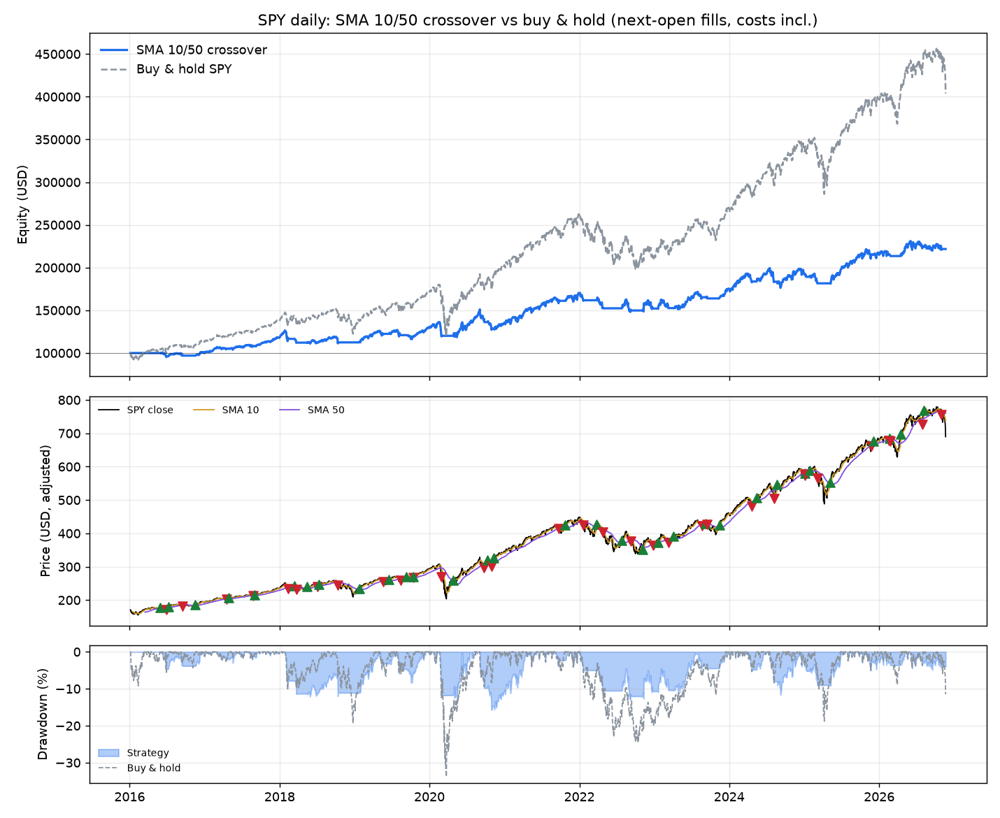
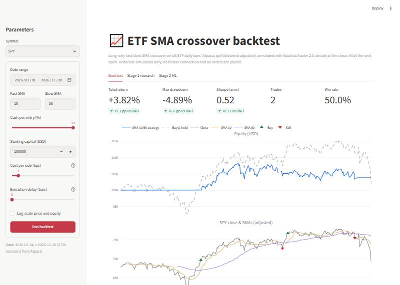

# ETF Trend Strategy Research (NautilusTrader v2)

A reproducible research and forward-testing project for a classic trend rule on
US ETFs (**SPY, QQQ, IWM**), built on the
[NautilusTrader](https://nautilustrader.io) 2.0 release candidate.

**Rule:** buy when the 10-day simple moving average crosses above the 50-day SMA,
and sell to cash when it crosses back below. Long only, no leverage.

**Execution model:** each decision is made on the daily close and **filled at the
next session's open**, which is how a daily ETF strategy is actually traded.
Costs are a 1 bp half-spread at the open plus 0.03% per side.

**Data:** daily bars from [Alpaca's Market Data API](https://docs.alpaca.markets/),
split- and dividend-adjusted, from 2016. Alpaca needs a free account and API keys,
which you keep in a git-ignored `.env` file.

Nothing in this repo places orders. The forward test is paper trading with no
broker connection.

## Results (Jan 2016 to Nov 2026, 2,738 sessions)

**Backtest, SMA 10/50 vs buy & hold** (99% of cash per entry, next-open fills, costs included):

| ETF | Strategy return | Buy & hold | Strategy max DD | Buy & hold max DD | Strategy Sharpe | B&H Sharpe | Trades |
|---|---:|---:|---:|---:|---:|---:|---:|
| SPY | +122% | +304% | **−15.7%** | −33.8% | 0.74 | 0.82 | 32 |
| QQQ | +206% | +501% | **−21.7%** | −35.0% | 0.78 | 0.85 | 32 |
| IWM | +54% | +167% | −35.1% | −41.3% | 0.34 | 0.51 | 35 |



**Stage 1: is the edge real?** ([full report](reports/research/summary.md))

| | SPY | QQQ | IWM |
|---|---:|---:|---:|
| Walk-forward optimised, out-of-sample Sharpe | 0.68 | 0.57 | 0.13 |
| Fixed 10/50, same period | **0.80** | 0.72 | 0.32 |
| Buy & hold, same period | 0.85 | **0.89** | **0.47** |
| SMA pairs (of 34) that were profitable | 100% | 100% | 100% |
| 10/50 return beats random entry timing | 16% | 24% | 30% |

**Stage 2: machine learning.** Out-of-sample AUC for the next 5-day direction:

| Model | AUC (0.5 = coin flip) |
|---|---:|
| LightGBM | 0.500 |
| Logistic regression | 0.500 |
| Shuffled-label control | 0.496 |

**Stage 2b: ML or volatility targeting as a size filter.** Every scheme lowered the
average Sharpe (fixed 0.64 → 0.39–0.60). Model bet sizes were slightly *negatively*
related to trade outcomes (Spearman ρ −0.17).

### What this says

- **On these ETFs the trend rule is a risk reducer, not a return enhancer.** It cut
  the worst drawdown by about half on SPY and QQQ (e.g. it sat out most of the 2020
  crash and the 2022 bear market). It paid for that with far lower total returns and
  a slightly *lower* Sharpe than simply holding.
- **The timing itself showed no skill.** Random entry schedules with the same number
  of trades and the same holding lengths beat the 10/50 return 70–84% of the time.
  Its benefit came from being in cash roughly a third of the time, not from choosing *when*.
  This is weaker evidence than the crypto version found (there, the rule beat ~92% of
  random timings).
- **Optimising and ML both made things worse**, again. The out-of-sample tests
  caught it every time.
- **The sample matters.** 2016–2026 was a strong bull market for US equities, which
  is hard for any timing rule. It contains no prolonged bear market like 2000–02 or
  2008, when trend filters have historically mattered most, and Alpaca's data
  doesn't go back far enough to test that here.

If the goal is fewer large drawdowns, the rule did deliver that. If the goal is
beating buy & hold, nothing tested here did.



**Forward test:** started at the 2026-11-20 close. All three ETFs are in a downtrend
(SMA10 below SMA50), so it is currently in cash.

## Setup

Requires Python 3.12. Commands are shown for Windows PowerShell.

```powershell
python -m venv .venv
.\.venv\Scripts\Activate.ps1
pip install -r requirements.txt     # pins nautilus-trader==2.0.0rc6
```

1. Create a free account at [alpaca.markets](https://alpaca.markets). Paper-trading
   keys are fine; only market data is read.
2. Copy `.env.example` to `.env` and paste in your keys:

   ```
   ALPACA_API_KEY_ID=...
   ALPACA_API_SECRET_KEY=...
   ```

   `.env` is git-ignored, and the scripts never print the keys.
3. Download the data:

   ```powershell
   python scripts/download_data.py     # SPY, QQQ, IWM from 2016 -> data/raw/<SYMBOL>_1d.csv
   ```

   ```powershell
   python -m src.data_loader           # verify: sessions, gaps, OHLC sanity
   ```

## What you can run

| Command | What it does | Output |
|---|---|---|
| `python scripts/run_backtest.py` | 10/50 backtest per ETF vs buy & hold | `reports/<SYMBOL>_*`, `reports/summary.md` |
| `python scripts/run_research.py` | **Stage 1:** walk-forward, parameter sensitivity, random-entry baseline, cost/delay robustness | `reports/research/` |
| `python scripts/run_ml.py` | **Stage 2:** can an ML model (LightGBM, logistic regression) time ETFs? | `reports/ml/` |
| `python scripts/run_ml_sizing.py` | **Stage 2b:** ML or volatility targeting as a position-size filter | `reports/ml_sizing/` |
| `streamlit run app/streamlit_app.py` | Interactive dashboard: run backtests and browse research | localhost:8501 |
| `python scripts/forward_test.py` | **Stage 3:** daily forward test (paper trading) | `paper/forward_status.md` |
| `python -m pytest -q` | 103 tests | |

## How it works

```
src/alpaca_data.py          Alpaca market-data client (read-only), .env keys, partial-bar guard
src/data_loader.py          load/validate daily bars; Nautilus Equity; 16:00 ET bars; 09:30 ET open quotes
src/strategies/
  sma_crossover.py          the strategy: decide at close, execute on the next open quote
  ml_signal.py              long-only strategy driven by model probabilities (Stage 2)
  scheduled.py              random-schedule strategy for the luck baseline (Stage 1)
src/backtest.py             Nautilus BacktestEngine: USD cash account, fee model, equity rebuilt from fills
src/pipeline.py             one call: data -> backtest -> aligned equity curves, stats, trades
src/metrics.py              return, max drawdown, Sharpe (252 sessions/yr), win rate, buy & hold
src/research.py             sensitivity grid, walk-forward, random baseline, cost x delay grid
src/ml/                     leakage-safe features, purged walk-forward training, evaluation, sizing
src/paper/forward.py        forward test: replay the strategy from a fixed start date each day
```

Modelling choices:

- **No look-ahead.** Bars are stamped at the 16:00 New York close (handling
  daylight saving). A decision on a close can only fill at a later open. The
  downloader also drops today's bar until the session is over.
- **Next-open fills.** The backtest feeds a quote at each 09:30 open (bid/ask = open
  ∓ 1 bp), and the strategy submits its market order on that quote. Buys pay the
  ask and sells hit the bid.
- **Whole shares, never over-buying.** Entries invest 99% of cash, rounded **down**
  to whole shares. Rounding to the nearest share can exceed the cash available, and
  Nautilus's risk engine rightly denies those orders.
- **Dividends included.** Prices are total-return adjusted, so buy & hold and the
  strategy both earn dividends while invested. Cash earns nothing, which is
  conservative for the strategy.
- **Equity curve** is rebuilt from individual fills (cash + shares × close) at every
  session, and tests reconcile it with realised P&L.

## Forward test (paper trading)

```powershell
python scripts/forward_test.py      # run once per trading day, after ~16:20 New York time
```

- **First run:** fixes the start date (the latest completed session) in
  `paper/forward_state.json`.
- **Every later run:** refreshes Alpaca data and replays the exact backtest
  strategy, allowing trades only from the start date onward. Each ETF starts with
  $10,000 of simulated cash.
- **Output:** for each ETF, the trend, shares held, equity since the start, every
  fill, and the **action due at the next open** (BUY, SELL or HOLD). This goes to
  `paper/forward_status.md` and `paper/forward_journal.jsonl` (both git-ignored).
- **Restart-safe:** every run recomputes from the start date, so missed days or
  reboots don't matter.
- **Starting over:** `--reset` begins a new forward test.

Because the strategy trades only a few times a year per ETF, the forward test needs
months to say much. Its job is to confirm that live data, signals and timing behave
exactly as in the backtest before any real money is involved.

## Going live later (not built)

The recommended path is NautilusTrader's **Interactive Brokers adapter**, which
covers stocks and ETFs. The same `SmaCrossover` strategy would run in a `LiveNode`
connected to IB Gateway, starting with an IBKR **paper** account. That needs your
IBKR login and is deliberately not part of this repo yet.

## Tests

- **`tests/test_etf.py`:**
  - New York session timestamps across daylight-saving changes.
  - Loading the CSVs, validating trading days, and catching missing weeks.
  - Next-open fills at the ask.
  - Round-down share sizing.
  - Equity reconciliation.
  - The partial-bar guard.
  - `.env` handling, and a check that the Alpaca client is market-data only.
  - The forward test.
- **`tests/test_signals.py`, `tests/test_warmup.py`:** crossover logic, and no trades
  before the 50-session warmup.
- **`tests/test_backtest_smoke.py`:** accounting consistency, and the CLI end to end
  on a synthetic CSV (plus real data when present).
- **`tests/test_research.py`, `tests/test_ml.py`, `tests/test_sizing.py`:**
  - The walk-forward folds are truly out-of-sample.
  - Features never use future data.
  - Planted-signal recovery, and noise and shuffled-label controls.
  - The sizing hooks.
- **`tests/test_app.py`:** the dashboard renders, checked headlessly.

## Project history: the crypto version

This project started as a BTC/ETH/SOL study on Binance data. That version, with all
of its research, is preserved at the git tag **`crypto-final`**. Its main findings
carry over as lessons:

- **Optimising hurt.** Re-optimising the SMA parameters walk-forward did worse out
  of sample than keeping 10/50.
- **The trend effect was modest.** It was real-looking (every parameter pair was
  profitable, and the rule beat about 92% of random timings), but its edge was
  mainly smaller drawdowns.
- **ML found nothing.** ML models on price and volume features reached an AUC of
  about 0.51, no better than a shuffled-label control. They lost to the simple rule
  as signals and didn't help as position sizers.

## Disclaimer

This is research software. A backtest is not evidence that a rule will work in
the future: it describes one period, with simplified execution, and every
parameter choice made after looking at results risks overfitting. Nothing here
is investment advice.
