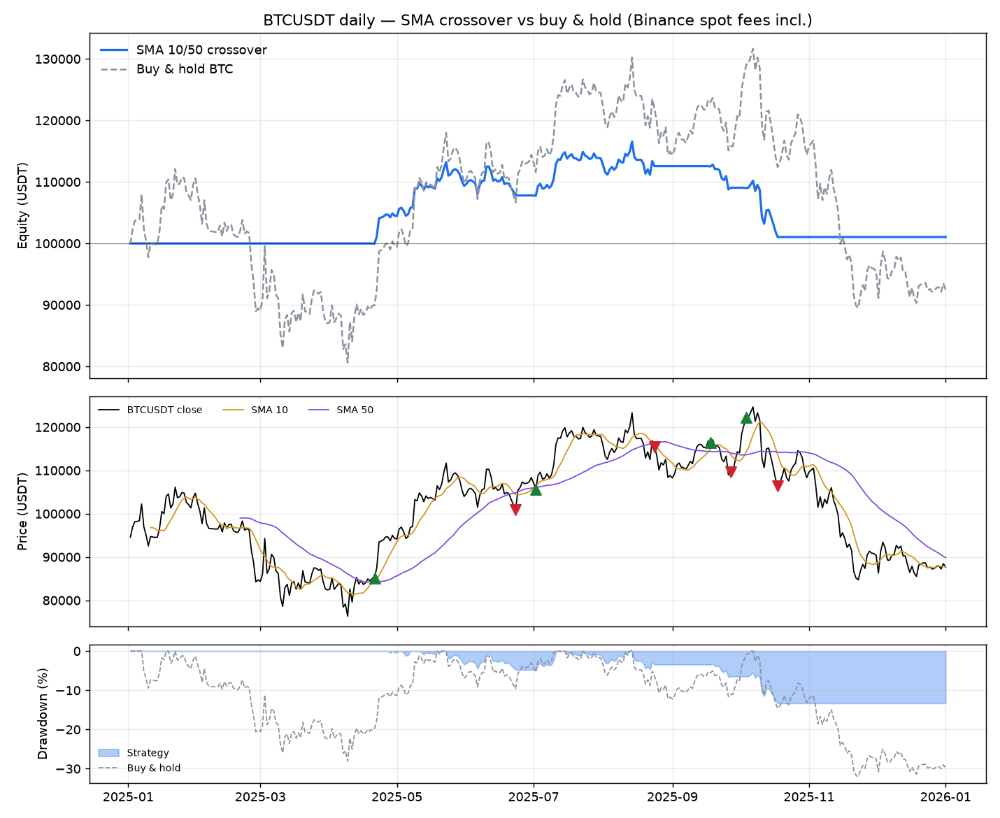
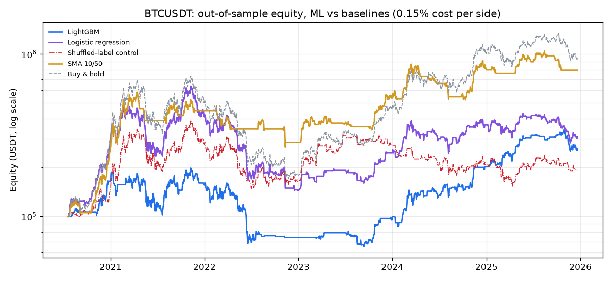

# BTC SMA Crossover Backtest (NautilusTrader v2)

A small, fully reproducible backtest of a classic trend-following rule on Bitcoin,
built on the [NautilusTrader](https://nautilustrader.io) 2.0 release candidate's
event-driven `BacktestEngine`.

**Rule:** on BTCUSDT daily bars, buy a fixed 0.5 BTC when the 10-day simple moving
average crosses above the 50-day SMA, and sell back to flat when it crosses below.
Long only, no leverage, Binance spot taker fees (0.1% per side) on every fill.

**Data:** calendar year 2025 BTCUSDT 1d klines from Binance's public archive,
[data.binance.vision](https://data.binance.vision). No API keys, no accounts, and
nothing in this repo places live or paper orders.

## Results (2025-01-01 → 2025-12-31)



| Metric | SMA 10/50 crossover | Buy & hold BTC |
|---|---:|---:|
| Total return | +1.04% | −7.53% |
| Final equity (USDT) | 101,037.54 | 92,474.30 |
| Number of trades (round trips) | 4 | 1 |
| Win rate | 50% | 0% |
| Max drawdown | −13.32% | −32.02% |
| Sharpe ratio (daily returns, annualised ×√365, rf = 0) | 0.15 | 0.02 |

Starting capital is 100,000 USDT for both. Buy & hold puts all of it into BTC at the
first daily close and sells at the last, paying the 0.1% fee on both sides.

| Opened (UTC) | Closed (UTC) | Entry | Exit | Qty (BTC) | Net PnL (USDT) |
|---|---|---:|---:|---:|---:|
| 2025-04-21 | 2025-06-23 | 85,179.24 | 100,963.87 | 0.5 | +7,799.24 |
| 2025-07-02 | 2025-08-24 | 105,681.14 | 115,438.05 | 0.5 | +4,767.90 |
| 2025-09-18 | 2025-09-27 | 116,447.59 | 109,643.46 | 0.5 | −3,515.11 |
| 2025-10-04 | 2025-10-18 | 122,232.00 | 106,431.68 | 0.5 | −8,014.49 |

Full outputs are in [`reports/`](reports): `summary.md`, `metrics.json`, `trades.csv`
and `equity_curve.png`.

### How to read these numbers

- **The comparison isn't like for like on exposure.** The strategy holds a fixed 0.5 BTC,
  roughly 40–60% of the account depending on price. Buy & hold is 100% invested.
  A good part of the smaller drawdown comes from simply holding less BTC, not from
  the timing signal.
- **Four trades is not a sample.** One year of daily bars gives a handful of round
  trips. A win rate of 50% on four trades says almost nothing, and the result swings
  on one or two of them. In 2025 the rule caught the April–August rally, then gave
  back most of it in two whipsaws around the October top.
- **Warmup.** The 50-day SMA needs 50 bars, so the strategy can't act before
  mid-February. Buy & hold is measured over the full year.

## Interactive dashboard

A Streamlit app runs the same Nautilus backtest live. You can change the date
range, SMA periods, trade size and starting capital, then compare the strategy
with buy & hold on interactive charts.

```powershell
streamlit run app/streamlit_app.py      # opens http://localhost:8501
```


The app has the following:

- A symbol picker (BTC, ETH, SOL), sizing by % of cash or fixed quantity, and
  sliders for slippage and execution delay.
- **Stage 1 research** and **Stage 2 ML** tabs. The Stage 1 tab presents the walk-forward, sensitivity,
  random-baseline and robustness results described below.
- Metric cards for return, drawdown and Sharpe, each with the gap versus buy & hold.
- Linked equity, price/SMA and drawdown charts with buy and sell markers.
- The trades table with a CSV download.
- A warning when the trade size can cost more than the account holds. Nautilus's
  risk engine denies those entries.

The app and `scripts/run_backtest.py` share `src/pipeline.py`, so both always
report the same numbers. The app reads only local archive data and never
connects to an exchange.

## Stage 1 research: is the edge real?

One good year proves nothing, so `scripts/run_research.py` tests the rule on
**BTC, ETH and SOL from 2018 to 2025** (SOL from its 2020 listing). It asks four
questions, all through the same Nautilus engine. Every run invests 99% of cash
per entry and pays 0.10% fee + 0.05% slippage per side.

**1. Does re-optimising parameters help?** Walk-forward: on each 2-year window,
pick the best of 34 SMA pairs by Sharpe, then trade it untouched for the next
6 months, and roll forward. Only those out-of-sample months are stitched together.

| Symbol | Out-of-sample | Walk-forward optimised | Fixed 10/50 | Buy & hold |
|---|---|---:|---:|---:|
| BTCUSDT | Jul 2020 to Dec 2025 | +341% (Sharpe 0.87, DD −53%) | +740% (1.14, −54%) | +854% (1.00, −77%) |
| ETHUSDT | Jul 2020 to Dec 2025 | +546% (0.88, −61%) | +1825% (1.21, −50%) | +1142% (0.98, −79%) |
| SOLUSDT | Feb 2023 to Dec 2025 | +166% (0.85, −57%) | +463% (1.26, −52%) | +448% (1.12, −60%) |


**2. Is it one lucky parameter pair?** No. All 34 fast/slow pairs were profitable
on every asset, with Sharpe ratios between about 0.6 and 1.4.

**3. Is the timing better than luck?** The 10/50 rule beat 92% (BTC, ETH) and
100% (SOL) of 200 random entry schedules that had the same number of trades and
the same holding lengths.

**4. Does it survive costs and late fills?** Raising costs to 0.30% per side
barely moves Sharpe, because the rule only trades a few times a year. Acting 1–2
days late hurts more: BTC's Sharpe drops from 0.92 to 0.73.

### What this says

- **Optimising made things worse.** Parameters that were best in the last 2 years
  underperformed the plain 10/50 rule in the next 6 months, on all three assets.
  This is the classic overfitting result, and the reason to always test out of
  sample before trusting a tuned model.
- **The broad trend-following effect looks real but modest.** It works across
  parameters and assets and beats most random timings. Its advantage over buy & hold
  is mostly a **shallower drawdown**, not reliably higher returns.
- **The evidence is weaker than it looks.** Beating 92% of random schedules is
  roughly a p ≈ 0.08 result, which is not conventionally significant. And
  2018–2025 was an unusually strong period for crypto.

The full tables and per-symbol charts are in
[`reports/research/summary.md`](reports/research/summary.md). The dashboard's
**Stage 1 research** tab shows them interactively.

```powershell
python scripts/download_data.py --symbols BTCUSDT ETHUSDT SOLUSDT --start-year 2018 --end-year 2025
```

```powershell
python scripts/run_research.py      # ~90 s, writes reports/research/
```

Method notes:

- **Warmup and fresh capital:** every window gets extra warmup bars so the slow SMA
  is ready on its first day, and starts with fresh capital.
- **Fold boundaries:** if the fast SMA is already above the slow one when a window
  starts, the strategy enters immediately, so a trend crossing a fold boundary isn't
  skipped. Positions are closed at each fold's end, which adds a round trip of cost.
- **Random baseline:** it reuses the strategy's own holding lengths, so it tests
  *timing* at equal exposure.

## Stage 2: can machine learning do better?

`scripts/run_ml.py` asks whether a model can predict the next **5-day direction**
well enough to trade.

1. **Features:** 17 backward-looking, scale-free features per day: returns over
   1–60 days, volatility, SMA ratios, RSI, distance from 90-day high/low, a volume
   z-score and range ([`src/ml/features.py`](src/ml/features.py)). A test confirms
   that changing future prices never changes past features.
2. **Model:** one model is trained across BTC, ETH and SOL using a **purged
   walk-forward** ([`src/ml/walk_forward.py`](src/ml/walk_forward.py)). It trains
   on 2 years, drops the last 5 days (their labels overlap the test window), then
   predicts the next 6 months and rolls forward. Hyperparameters were fixed up
   front, not tuned.
3. **Trading:** the out-of-sample probabilities are traded through Nautilus by
   `MLSignalStrategy`. It enters at P ≥ 0.52 and exits at P ≤ 0.48, invests 99% of
   cash and pays 0.15% per side. The results are compared with SMA 10/50 and
   buy & hold on the same days.
4. **Controls:** logistic regression serves as a simple baseline, and LightGBM
   trained on **shuffled labels** shows what pure noise looks like.

**Prediction quality (out-of-sample AUC, 0.5 = coin flip):** LightGBM 0.507,
logistic regression 0.516, shuffled-label control 0.497.

**Trading results (out-of-sample, after costs):**

| Symbol | Period | LightGBM | Logistic reg. | Shuffled control | SMA 10/50 | Buy & hold |
|---|---|---:|---:|---:|---:|---:|
| BTCUSDT | Jul 2020 to Dec 2025 | +162% | +210% | +92% | **+698%** | +854% |
| ETHUSDT | Jul 2020 to Dec 2025 | −19% | +104% | +321% | **+1727%** | +1142% |
| SOLUSDT | Feb 2021 to Dec 2025 | +88% | +234% | +131% | **+3831%** | +854% |



### What this says

- **The model has essentially no out-of-sample skill.** An AUC of 0.51 is barely
  distinguishable from the shuffled-label control. The model's confidence is
  meaningless: whether it predicts 35% or 80%, about 53% of cases go up (see
  [`calibration.png`](reports/ml/calibration.png)).
- **It loses to the 2-line SMA rule on every asset.** It trades 5× more often,
  pays more in costs, and spends ~40% of the time out of the market during strong
  bull runs. Changing the thresholds doesn't rescue it, and on ETH the shuffled
  control did better.
- **This is the expected result, and the reason to build the harness first.**
  Daily price-and-volume features are public and heavily arbitraged. A model on
  them alone is unlikely to find durable short-horizon edge. Without the
  walk-forward, purging and controls, an in-sample version of this model would
  have looked great.

Directions that might plausibly help (not yet tested): longer horizons that
align with the trend effect Stage 1 found, regime filters that *size* the SMA
rule rather than replace it, and data that isn't pure price (funding rates,
on-chain flows, order-book imbalance).

```powershell
python scripts/run_ml.py            # ~15 s, writes reports/ml/
```

The dashboard's **Stage 2 ML** tab shows the AUC per fold, calibration, feature
importance, and equity curves for each symbol.

## How it works

```
scripts/download_data.py   →  data/raw/BTCUSDT-1d-2025-MM.csv   (SHA256-verified)
src/data_loader.py         →  pandas OHLCV → validated → Nautilus Bar objects
src/strategies/sma_crossover.py  SmaCrossover(Strategy) + SmaCrossoverConfig
src/backtest.py            →  BacktestEngine, simulated Binance spot venue, equity curve
src/metrics.py             →  return, drawdown, Sharpe, win rate, buy-and-hold baseline
src/pipeline.py            →  one call: bars → backtest → aligned curves, stats, trades
src/research.py            →  sensitivity grid, walk-forward, random baseline, cost/delay grid
scripts/run_research.py    →  Stage 1 research across symbols, writes reports/research/
src/ml/                    →  features/labels, purged walk-forward training, evaluation
src/strategies/ml_signal.py   long-only strategy driven by model probabilities
scripts/run_ml.py          →  Stage 2 ML experiment, writes reports/ml/
scripts/run_backtest.py    →  CLI: runs the pipeline, writes reports/
app/streamlit_app.py       →  interactive dashboard on the same pipeline
```

Modelling choices:

- **No look-ahead.** Each daily bar is stamped with its *close* time (open + 24h),
  so the strategy only sees a day's close once that day is over.
- **Fills.** Market orders fill at the close of the bar that triggered the signal,
  as a taker, with a `MakerTakerFeeModel(0.001, 0.001)` on the venue. BTC trades
  24/7, so the daily close is effectively the next day's open, but there is
  **no slippage model**.
- **Venue.** Binance spot is simulated as a multi-currency `CASH` account
  (USDT + BTC) with `NETTING` positions. Equity is marked to market every bar as
  `USDT + BTC × close`.
- **End of test.** Any open position is closed on the final bar, so every trade is
  realised in the stats. In 2025 the strategy was already flat by then.
- **Signal rule.** `crossover_signal()` is a pure function: the spread `fast − slow`
  must move from `≤ 0` to `> 0` to enter, or from `≥ 0` to `< 0` to exit. It is unit
  tested separately from the engine.

## How to run

Requires Python 3.12. Commands are shown for Windows PowerShell. On macOS or Linux,
use `source .venv/bin/activate` instead.

```powershell
python -m venv .venv
.\.venv\Scripts\Activate.ps1
pip install -r requirements.txt     # pins nautilus-trader==2.0.0rc6
```

```powershell
python scripts/download_data.py     # ~12 small zips from data.binance.vision → data/raw/
```

```powershell
python scripts/run_backtest.py      # prints the table, writes reports/
```

```powershell
python -m pytest -q                 # 77 tests, ~10 s
```

Useful flags for the runner: `--fast 20 --slow 100`, `--trade-size 0.25`, `--capital 50000`,
`--start 2025-03-01 --end 2025-12-31`. The downloader accepts `--year`, `--symbol`,
`--interval` and `--force`.

The data loader can be run directly to re-verify the dataset (365 rows, no gaps,
OHLC sanity):

```powershell
python -m src.data_loader
```

## Tests

- `tests/test_signals.py`: crossover edge cases (touching zero, no prior value),
  known crossovers on hand-built price series, and config validation.
- `tests/test_warmup.py`: no signals or fills before 50 bars, even when the trend
  is obvious from bar 10, and a cross right after warmup *does* trade at that
  bar's close.
- `tests/test_backtest_smoke.py`: a synthetic run reconciles final equity with
  realised PnL and checks fees are charged. An end-to-end run of the script
  produces every report file (skipped if `data/raw/` is empty).
- `tests/test_research.py`: execution delay, cash-based sizing, trade-start
  warmup, joining a trend at a fold start, multi-asset instruments, the
  random-schedule generator and walk-forward fold integrity.
- `tests/test_ml.py`: no feature leakage, label maths, purge gap between train
  and test, recovering a planted signal, finding nothing in noise or shuffled
  labels, the ML decision rule, and an ML strategy run in Nautilus.
- `tests/test_app.py`: the shared pipeline aligns and reconciles its curves, and the
  Streamlit app renders the default backtest headlessly via `AppTest`.

## Project layout

```
src/            strategy, data loader, engine wrapper, metrics, pipeline
app/            Streamlit dashboard
scripts/        download_data.py, run_backtest.py
tests/          pytest suite
data/raw/       downloaded CSVs (git-ignored)
reports/        generated summary, metrics, trades and chart; research/ (Stage 1), ml/ (Stage 2)
docs/           README images
```

## Notes on NautilusTrader 2.0

The 2.0 RC is a Rust/pyo3 rewrite, and several 1.x patterns no longer apply:

- Fees live on the venue's `fee_model` (required), not on the instrument.
- Reports come from `engine.generate_*_report()`. There is no `engine.trader`.
- A spot cash venue needs `base_currency=None`.
- `StrategyConfig` subclasses must set custom fields in `__init__`.
- Exceptions inside strategy handlers are logged, not raised. The runner and tests
  check `bars_seen` and fill counts so a silent failure can't pass.

## Disclaimer: a backtest is not evidence the rule works

This is one rule, one asset and one year, tested on the same data used to write it.
Even with fees included and look-ahead avoided, the result is a description of what
*would have happened* in 2025, not a prediction.

- The sample is tiny: 4 trades.
- The outcome depends heavily on the regime. Moving-average crossovers do well in long
  trends and lose money in choppy markets.
- Slippage, spread, funding of idle cash, taxes and execution delays are not modelled.
- Any parameter tweak made after looking at this chart would overfit it.

To learn anything durable you would need multiple years and assets, out-of-sample
and walk-forward testing, sensitivity analysis across parameters, and a realistic
execution model. Nothing here is investment advice.
