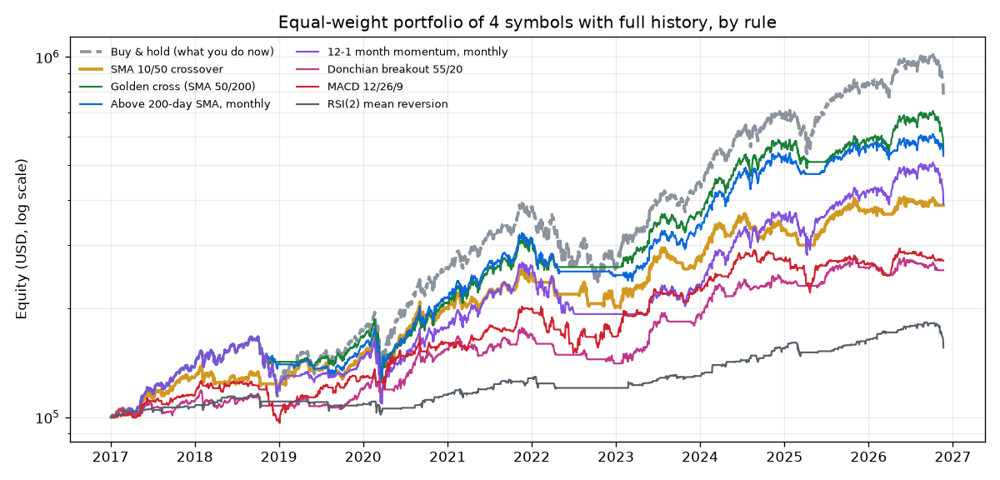
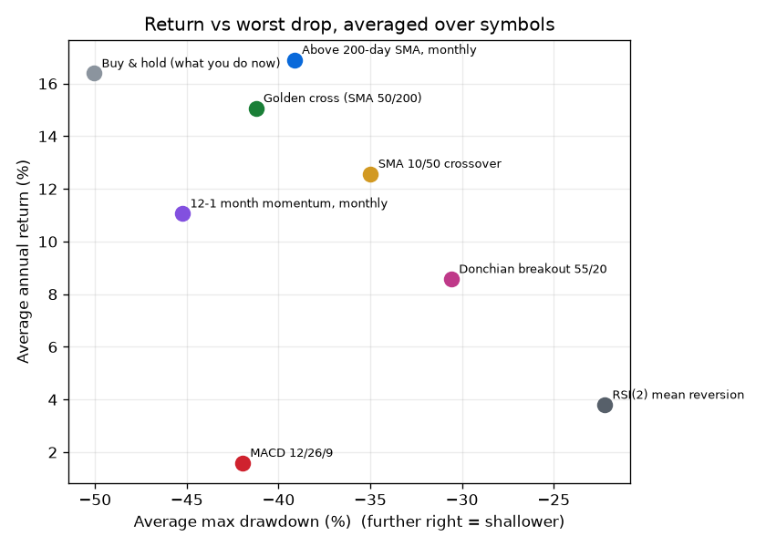
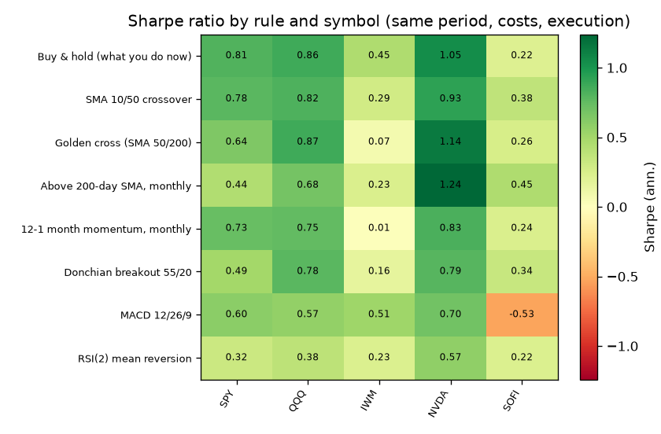

# Strategy comparison

5 symbols. Every rule trades the same sessions per symbol (after a 252-session warm-up), invests 99% of cash, decides at the close and fills at the next open (1 bp half-spread) plus 0.03% per side. Long or cash only.

## Overall ranking (averaged across symbols)

| Rule | Avg rank | Avg Sharpe | Avg CAGR | Avg max DD | In market | Trades | Beats B&H Sharpe | Beats B&H return | Shallower DD |
|---|---:|---:|---:|---:|---:|---:|---:|---:|---:|
| SMA 10/50 crossover | 2.8 | 0.64 | +12.6% | -35.0% | 64% | 29 | 1/5 | 1/5 | 5/5 |
| Buy & hold (what you do now) | 3.0 | 0.68 | +16.4% | -50.1% | 100% | 1 | 0/5 | 0/5 | 0/5 |
| Golden cross (SMA 50/200) | 3.6 | 0.60 | +15.1% | -41.2% | 74% | 5 | 3/5 | 2/5 | 4/5 |
| Above 200-day SMA, monthly | 3.8 | 0.61 | +16.9% | -39.1% | 74% | 8 | 2/5 | 2/5 | 4/5 |
| Donchian breakout 55/20 | 5.0 | 0.51 | +8.6% | -30.6% | 47% | 20 | 1/5 | 1/5 | 5/5 |
| 12-1 month momentum, monthly | 5.2 | 0.51 | +11.1% | -45.2% | 77% | 5 | 1/5 | 1/5 | 4/5 |
| MACD 12/26/9 | 5.6 | 0.37 | +1.6% | -42.0% | 52% | 92 | 1/5 | 0/5 | 4/5 |
| RSI(2) mean reversion | 7.0 | 0.35 | +3.8% | -22.2% | 11% | 71 | 1/5 | 1/5 | 5/5 |

**Ranking stability:** the rank correlation of the rules' Sharpe ratios between the first and second half of each period averages **+0.22** (1 = same order both halves, 0 = unrelated). Low values mean the 'best' rule is largely luck of the period.

## Equal-weight portfolio (4 full-history symbols, from 2017-01-03)

| Rule | Return | Sharpe | Max DD |
|---|---:|---:|---:|
| Above 200-day SMA, monthly | +430.3% | 0.98 | -26.5% |
| Buy & hold (what you do now) | +675.9% | 0.95 | -39.5% |
| Golden cross (SMA 50/200) | +443.1% | 0.95 | -32.8% |
| SMA 10/50 crossover | +287.2% | 0.93 | -22.0% |
| Donchian breakout 55/20 | +155.7% | 0.80 | -20.4% |
| MACD 12/26/9 | +171.7% | 0.77 | -25.7% |
| 12-1 month momentum, monthly | +290.4% | 0.74 | -34.8% |
| RSI(2) mean reversion | +55.9% | 0.59 | -15.0% |

## Best rule per symbol (by Sharpe)

| Symbol | Period | Best rule | Its Sharpe | B&H Sharpe | 10/50 Sharpe | Its return | B&H return |
|---|---|---|---:|---:|---:|---:|---:|
| SPY | 2017-01-03 to 2026-11-20 | Buy & hold (what you do now) | 0.81 | 0.81 | 0.78 | +251.4% | +251.4% |
| QQQ | 2017-01-03 to 2026-11-20 | Golden cross (SMA 50/200) | 0.87 | 0.86 | 0.82 | +351.8% | +439.3% |
| IWM | 2017-01-03 to 2026-11-20 | MACD 12/26/9 | 0.51 | 0.45 | 0.29 | +90.5% | +111.6% |
| NVDA | 2017-01-03 to 2026-11-20 | Above 200-day SMA, monthly | 1.24 | 1.05 | 0.93 | +6848.7% | +4782.0% |
| SOFI | 2021-11-30 to 2026-11-20 | Above 200-day SMA, monthly | 0.45 | 0.22 | 0.38 | +66.4% | -28.1% |

## Charts

 
