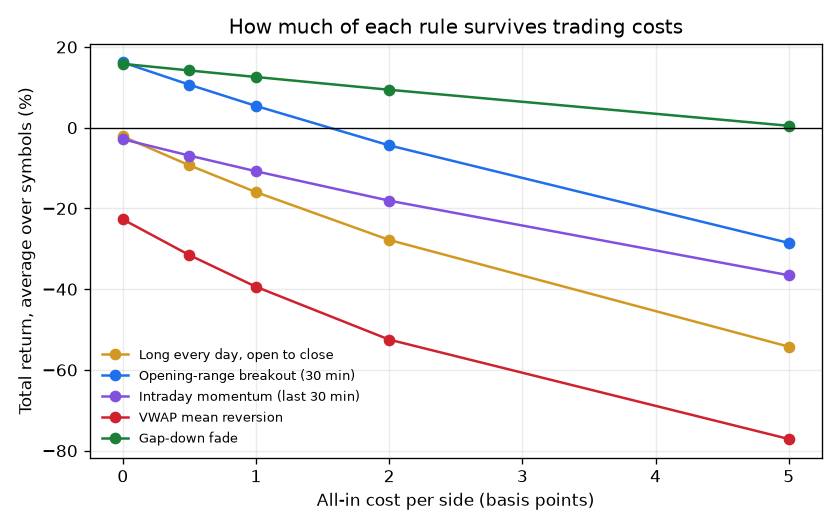
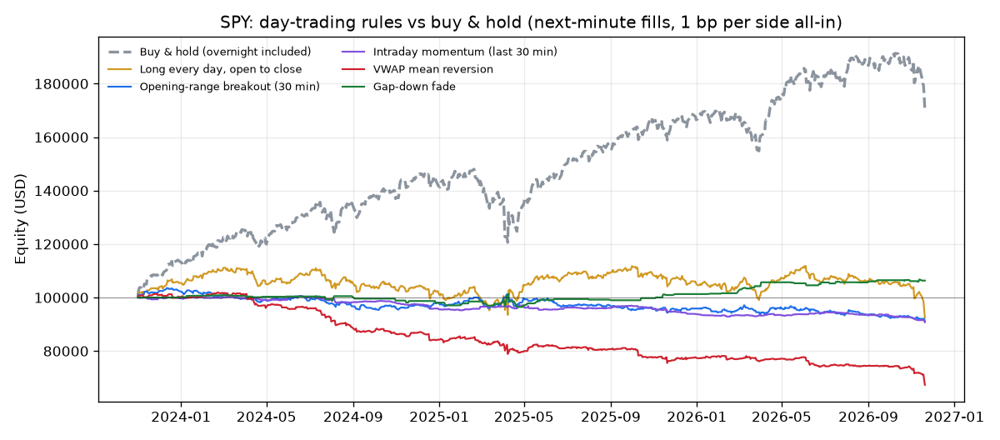
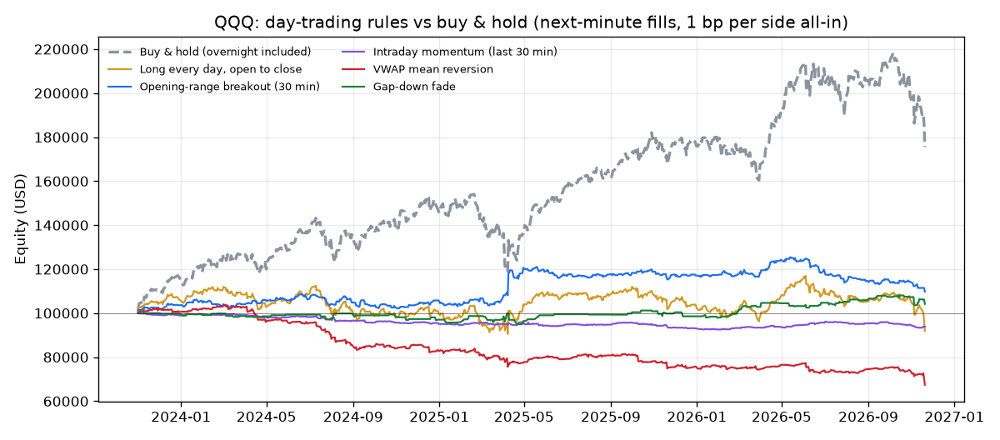
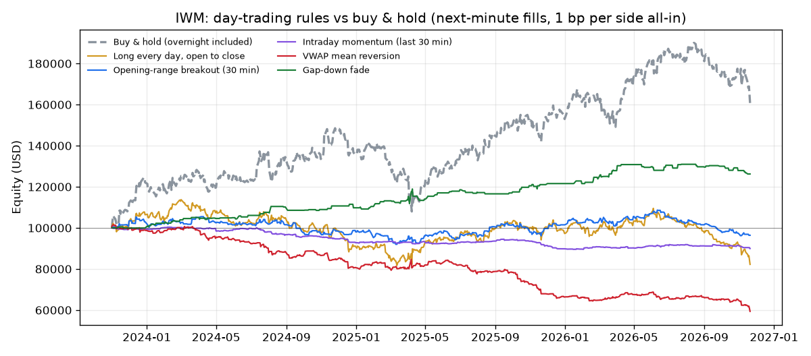
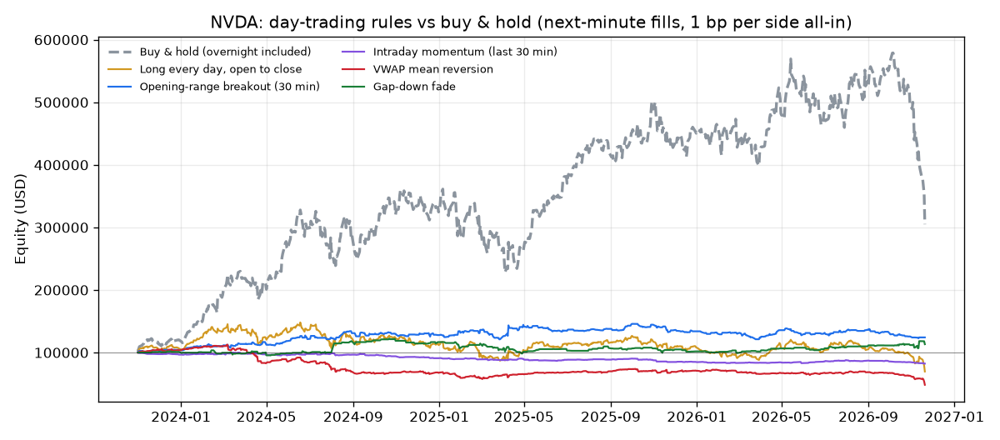

# Stage 4: day trading

1-minute bars, regular hours, 2023-11-01 to 2026-11-20 (767 sessions). Long only. Each rule decides on a minute's close and fills at the next minute's open (0.5 bp half-spread + 0.5 bp per side, about 1 bp per side all-in), and every day-trading rule is flat by the close.

## Results

| Symbol | Rule | Return | Sharpe | Max DD | Trades | Avg trade (bp) | Win rate | In market |
|---|---:|---:|---:|---:|---:|---:|---:|---:|
| SPY | Buy & hold (overnight included) | +69.9% | 1.23 | -18.5% | 1 | 7092.8 | 100% | 100% |
|  | Long every day, open to close | -7.5% | -0.14 | -17.3% | 767 | -0.7 | 52% | 99% |
|  | Opening-range breakout (30 min) | -8.8% | -0.52 | -12.0% | 556 | -1.6 | 46% | 43% |
|  | Intraday momentum (last 30 min) | -9.2% | -1.37 | -9.7% | 448 | -2.2 | 45% | 4% |
|  | VWAP mean reversion | -32.6% | -1.73 | -33.8% | 1291 | -3.0 | 71% | 33% |
|  | Gap-down fade | +6.3% | 0.50 | -4.8% | 84 | 7.8 | 56% | 4% |
| QQQ | Buy & hold (overnight included) | +75.5% | 0.99 | -22.6% | 1 | 7627.4 | 100% | 100% |
|  | Long every day, open to close | -8.1% | -0.08 | -21.4% | 767 | -0.6 | 53% | 99% |
|  | Opening-range breakout (30 min) | +9.8% | 0.38 | -12.5% | 529 | 2.0 | 51% | 44% |
|  | Intraday momentum (last 30 min) | -6.2% | -0.79 | -7.4% | 434 | -1.5 | 48% | 4% |
|  | VWAP mean reversion | -32.6% | -1.34 | -34.9% | 1215 | -3.2 | 73% | 32% |
|  | Gap-down fade | +4.2% | 0.25 | -5.0% | 134 | 3.5 | 57% | 6% |
| IWM | Buy & hold (overnight included) | +60.7% | 0.84 | -27.3% | 1 | 6139.5 | 100% | 100% |
|  | Long every day, open to close | -17.7% | -0.29 | -28.1% | 767 | -2.0 | 49% | 99% |
|  | Opening-range breakout (30 min) | -3.6% | -0.10 | -12.7% | 472 | -0.5 | 48% | 40% |
|  | Intraday momentum (last 30 min) | -10.0% | -1.26 | -10.8% | 414 | -2.6 | 46% | 4% |
|  | VWAP mean reversion | -40.6% | -1.77 | -41.5% | 1209 | -4.2 | 69% | 36% |
|  | Gap-down fade | +26.2% | 1.29 | -4.7% | 144 | 16.8 | 61% | 6% |
| NVDA | Buy & hold (overnight included) | +205.0% | 1.01 | -47.3% | 1 | 20711.8 | 100% | 100% |
|  | Long every day, open to close | -30.2% | -0.13 | -52.9% | 767 | -1.9 | 51% | 99% |
|  | Opening-range breakout (30 min) | +24.2% | 0.51 | -16.9% | 426 | 6.2 | 50% | 38% |
|  | Intraday momentum (last 30 min) | -17.7% | -1.05 | -17.7% | 423 | -4.5 | 50% | 4% |
|  | VWAP mean reversion | -51.5% | -1.06 | -56.9% | 1185 | -5.6 | 72% | 35% |
|  | Gap-down fade | +13.4% | 0.33 | -19.7% | 210 | 7.9 | 58% | 8% |

## Is it better than luck, and does it survive costs?

*Beats random* = share of random trade schedules (same trades per day, same holding times, random days and minutes) with a lower return. *Break-even* = all-in cost per side at which the average trade nets zero; liquid ETFs cost roughly 0.5–1 bp per side, retail market orders often more.

| Rule | SPY: beats random / break-even | QQQ: beats random / break-even | IWM: beats random / break-even | NVDA: beats random / break-even |
|---|---:|---:|---:|---:|
| Long every day, open to close | 0% / 0.6 bp | 0% / 0.7 bp | 0% / 0.0 bp | 0% / 0.0 bp |
| Opening-range breakout (30 min) | 64% / 0.2 bp | 95% / 2.0 bp | 69% / 0.7 bp | 91% / 4.1 bp |
| Intraday momentum (last 30 min) | 65% / -0.1 bp | 91% / 0.3 bp | 53% / -0.3 bp | 8% / -1.3 bp |
| VWAP mean reversion | 3% / -0.5 bp | 6% / -0.6 bp | 0% / -1.1 bp | 5% / -1.8 bp |
| Gap-down fade | 99% / 4.9 bp | 86% / 2.8 bp | 100% / 9.4 bp | 65% / 5.0 bp |

## Return by year (average over symbols)

| Rule | 2023* | 2024 | 2025 | 2026* |
|---|---:|---:|---:|---:|
| Buy & hold (overnight included) | +18.2% | +57.7% | +22.4% | -6.4% |
| Long every day, open to close | +6.1% | -4.8% | +2.6% | -18.4% |
| Opening-range breakout (30 min) | +3.2% | +4.1% | +4.2% | -5.9% |
| Intraday momentum (last 30 min) | -1.4% | -5.1% | -3.5% | -1.3% |
| VWAP mean reversion | +0.7% | -21.7% | -7.4% | -16.5% |
| Gap-down fade | +0.2% | +5.2% | +0.7% | +6.4% |

\*Partial year.

## Charts

