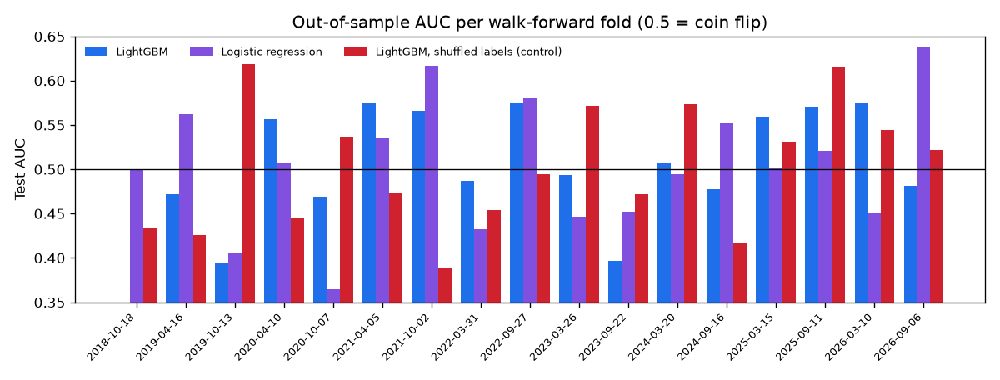
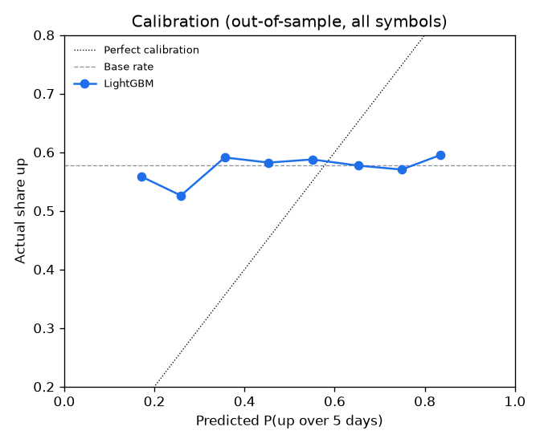
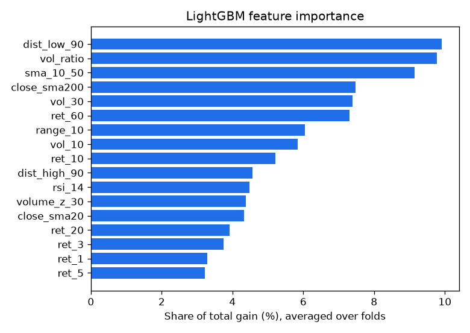
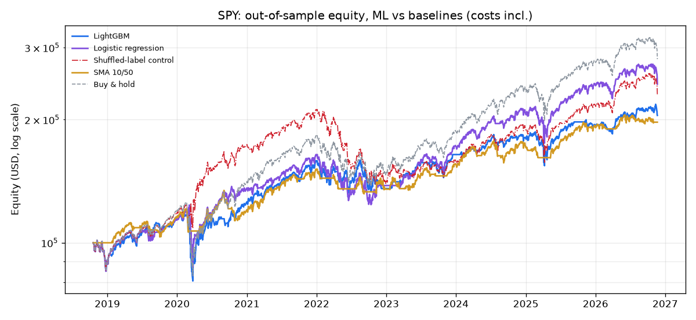

# Stage 2 ML summary

Label: sign of the next 5-day return. 17 backward-looking features, one model pooled across symbols, purged walk-forward (train 730 days, test 180, 5-day purge). Trading: enter at P >= 0.52, exit at P <= 0.48, 99% of cash, 0.03% cost per side.

## Does the model predict direction? (out-of-sample)

| Model | Pooled AUC | SPY AUC | QQQ AUC | IWM AUC | Folds > 0.5 |
|---|---:|---:|---:|---:|---:|
| LightGBM | 0.500 | 0.491 | 0.480 | 0.522 | 47% |
| Logistic regression | 0.500 | 0.490 | 0.484 | 0.516 | 59% |
| LightGBM, shuffled labels (control) | 0.496 | 0.504 | 0.475 | 0.505 | 47% |

AUC 0.5 is a coin flip. The shuffled-label control shows what pure noise looks like.

## Does it make money? (out-of-sample, after costs)

| Symbol | OOS period | Approach | Return | Max DD | Sharpe | Trades |
|---|---:|---:|---:|---:|---:|---:|
| SPY | 2018-10-18 to 2026-11-20 | LightGBM | +104.8% | -31.3% | 0.60 | 108 |
|  |  | Logistic regression | +144.2% | -29.3% | 0.71 | 40 |
|  |  | Shuffled-label control | +129.9% | -34.8% | 0.67 | 106 |
|  |  | SMA 10/50 | +97.2% | -15.7% | 0.79 | 24 |
|  |  | Buy & hold | +181.2% | -33.8% | 0.77 | 1 |
| QQQ | 2018-10-18 to 2026-11-20 | LightGBM | +104.7% | -31.7% | 0.53 | 118 |
|  |  | Logistic regression | +95.6% | -33.0% | 0.50 | 63 |
|  |  | Shuffled-label control | +162.0% | -38.2% | 0.64 | 121 |
|  |  | SMA 10/50 | +137.5% | -21.7% | 0.78 | 26 |
|  |  | Buy & hold | +270.4% | -35.0% | 0.79 | 1 |
| IWM | 2018-10-18 to 2026-11-20 | LightGBM | +78.6% | -45.2% | 0.44 | 120 |
|  |  | Logistic regression | +42.6% | -35.8% | 0.31 | 57 |
|  |  | Shuffled-label control | +52.8% | -39.4% | 0.34 | 125 |
|  |  | SMA 10/50 | +39.3% | -35.1% | 0.34 | 26 |
|  |  | Buy & hold | +82.7% | -41.2% | 0.43 | 1 |

## Threshold sensitivity (LightGBM)

| Symbol | Enter / exit | Return | Sharpe | Trades | Time in market |
|---|---:|---:|---:|---:|---:|
| SPY | 0.50 / 0.50 | +102.7% | 0.60 | 143 | 85% |
|  | 0.52 / 0.48 | +104.8% | 0.60 | 108 | 84% |
|  | 0.55 / 0.45 | +124.3% | 0.66 | 70 | 83% |
|  | 0.60 / 0.40 | +152.6% | 0.75 | 40 | 82% |
| QQQ | 0.50 / 0.50 | +120.3% | 0.57 | 160 | 75% |
|  | 0.52 / 0.48 | +104.7% | 0.53 | 118 | 73% |
|  | 0.55 / 0.45 | +80.3% | 0.45 | 80 | 72% |
|  | 0.60 / 0.40 | +82.6% | 0.46 | 51 | 72% |
| IWM | 0.50 / 0.50 | +65.5% | 0.40 | 151 | 76% |
|  | 0.52 / 0.48 | +78.6% | 0.44 | 120 | 74% |
|  | 0.55 / 0.45 | +43.8% | 0.32 | 88 | 73% |
|  | 0.60 / 0.40 | +41.0% | 0.30 | 56 | 76% |

## Most-used features (LightGBM gain share)

`dist_low_90` 10%, `vol_ratio` 10%, `sma_10_50` 9%, `close_sma200` 7%, `vol_30` 7%

## Charts

 

