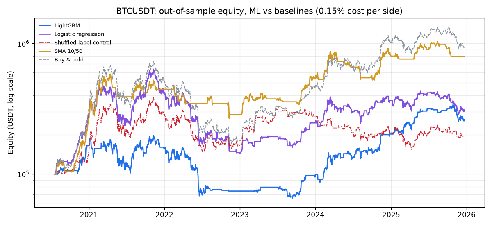
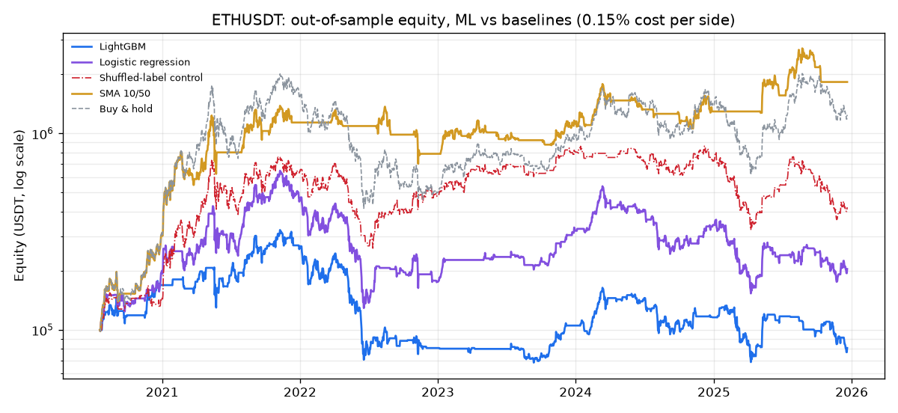
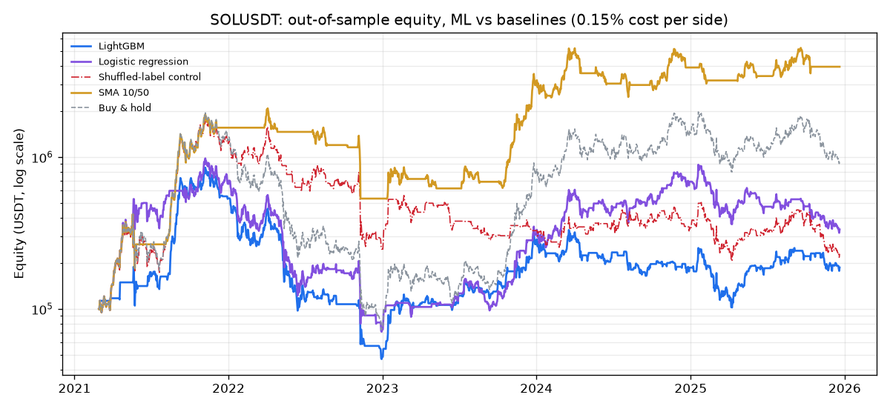

# Stage 2 ML summary

Label: sign of the next 5-day return. 17 backward-looking features, one model pooled across symbols, purged walk-forward (train 730 days, test 180, 5-day purge). Trading: enter at P >= 0.52, exit at P <= 0.48, 99% of cash, 0.15% cost per side.

## Does the model predict direction? (out-of-sample)

| Model | Pooled AUC | BTCUSDT AUC | ETHUSDT AUC | SOLUSDT AUC | Folds > 0.5 |
|---|---:|---:|---:|---:|---:|
| LightGBM | 0.507 | 0.515 | 0.508 | 0.500 | 64% |
| Logistic regression | 0.516 | 0.507 | 0.537 | 0.512 | 82% |
| LightGBM, shuffled labels (control) | 0.497 | 0.495 | 0.497 | 0.496 | 55% |

AUC 0.5 is a coin flip. The shuffled-label control shows what pure noise looks like.

## Does it make money? (out-of-sample, after costs)

| Symbol | OOS period | Approach | Return | Max DD | Sharpe | Trades |
|---|---:|---:|---:|---:|---:|---:|
| BTCUSDT | 2020-07-20 to 2025-12-20 | LightGBM | +162.4% | -67.2% | 0.62 | 111 |
|  |  | Logistic regression | +210.3% | -77.3% | 0.66 | 136 |
|  |  | Shuffled-label control | +92.4% | -61.7% | 0.49 | 163 |
|  |  | SMA 10/50 | +697.8% | -54.2% | 1.11 | 23 |
|  |  | Buy & hold | +854.2% | -76.6% | 1.00 | 1 |
| ETHUSDT | 2020-07-20 to 2025-12-20 | LightGBM | -19.1% | -78.9% | 0.22 | 122 |
|  |  | Logistic regression | +104.2% | -80.0% | 0.53 | 119 |
|  |  | Shuffled-label control | +320.9% | -65.6% | 0.73 | 158 |
|  |  | SMA 10/50 | +1727.1% | -49.6% | 1.19 | 25 |
|  |  | Buy & hold | +1142.3% | -79.3% | 0.98 | 1 |
| SOLUSDT | 2021-02-28 to 2025-12-20 | LightGBM | +87.7% | -94.5% | 0.59 | 122 |
|  |  | Logistic regression | +234.0% | -92.8% | 0.73 | 108 |
|  |  | Shuffled-label control | +130.5% | -88.4% | 0.65 | 147 |
|  |  | SMA 10/50 | +3830.5% | -74.7% | 1.34 | 18 |
|  |  | Buy & hold | +854.3% | -96.3% | 0.98 | 1 |

## Threshold sensitivity (LightGBM)

| Symbol | Enter / exit | Return | Sharpe | Trades | Time in market |
|---|---:|---:|---:|---:|---:|
| BTCUSDT | 0.50 / 0.50 | +170.8% | 0.63 | 150 | 61% |
|  | 0.52 / 0.48 | +162.4% | 0.62 | 111 | 59% |
|  | 0.55 / 0.45 | +143.0% | 0.59 | 59 | 56% |
|  | 0.60 / 0.40 | +140.4% | 0.58 | 29 | 55% |
| ETHUSDT | 0.50 / 0.50 | +75.3% | 0.47 | 162 | 59% |
|  | 0.52 / 0.48 | -19.1% | 0.22 | 122 | 57% |
|  | 0.55 / 0.45 | +57.6% | 0.43 | 77 | 55% |
|  | 0.60 / 0.40 | +50.8% | 0.42 | 40 | 54% |
| SOLUSDT | 0.50 / 0.50 | +67.5% | 0.56 | 164 | 69% |
|  | 0.52 / 0.48 | +87.7% | 0.59 | 122 | 66% |
|  | 0.55 / 0.45 | +40.1% | 0.52 | 85 | 64% |
|  | 0.60 / 0.40 | +64.1% | 0.56 | 53 | 64% |

## Most-used features (LightGBM gain share)

`close_sma200` 9%, `sma_10_50` 9%, `vol_30` 9%, `dist_low_90` 8%, `ret_60` 8%

## Charts

 

