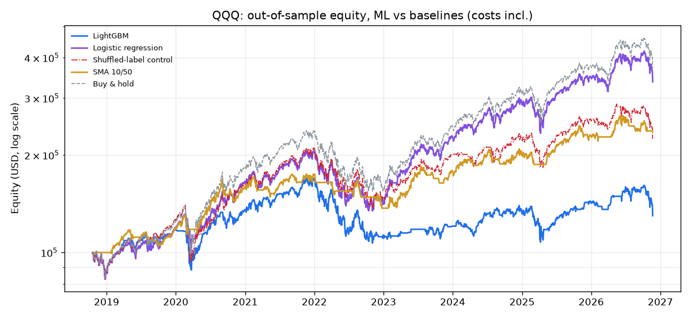
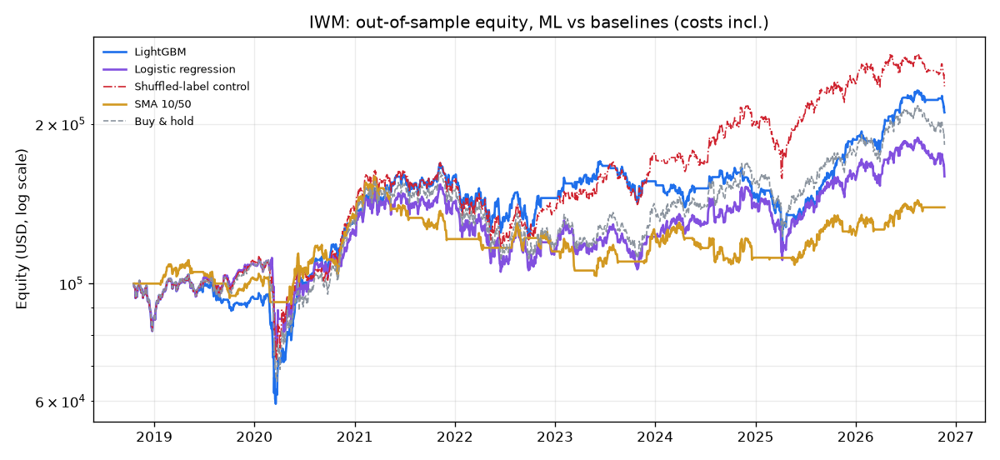
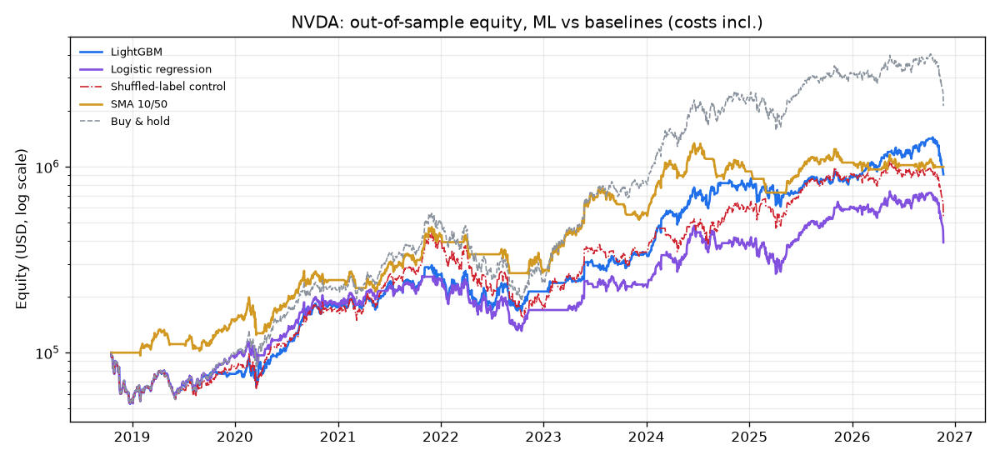
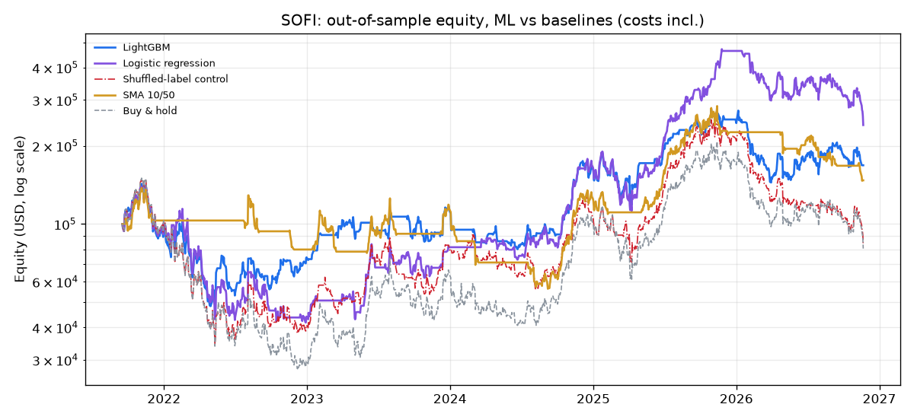

# Stage 2 ML summary

Label: sign of the next 5-day return. 17 backward-looking features, one model pooled across symbols, purged walk-forward (train 730 days, test 180, 5-day purge). Trading: enter at P >= 0.52, exit at P <= 0.48, 99% of cash, 0.03% cost per side.

## Does the model predict direction? (out-of-sample)

| Model | Pooled AUC | SPY AUC | QQQ AUC | IWM AUC | NVDA AUC | SOFI AUC | Folds > 0.5 |
|---|---:|---:|---:|---:|---:|---:|---:|
| LightGBM | 0.491 | 0.489 | 0.468 | 0.515 | 0.459 | 0.497 | 53% |
| Logistic regression | 0.485 | 0.483 | 0.473 | 0.508 | 0.457 | 0.496 | 41% |
| LightGBM, shuffled labels (control) | 0.496 | 0.498 | 0.491 | 0.522 | 0.459 | 0.502 | 65% |

AUC 0.5 is a coin flip. The shuffled-label control shows what pure noise looks like.

## Does it make money? (out-of-sample, after costs)

| Symbol | OOS period | Approach | Return | Max DD | Sharpe | Trades |
|---|---:|---:|---:|---:|---:|---:|
| SPY | 2018-10-18 to 2026-11-20 | LightGBM | +127.0% | -32.1% | 0.68 | 88 |
|  |  | Logistic regression | +189.6% | -24.4% | 0.82 | 19 |
|  |  | Shuffled-label control | +84.4% | -29.9% | 0.52 | 85 |
|  |  | SMA 10/50 | +97.2% | -15.7% | 0.79 | 24 |
|  |  | Buy & hold | +181.2% | -33.8% | 0.77 | 1 |
| QQQ | 2018-10-18 to 2026-11-20 | LightGBM | +29.9% | -37.0% | 0.26 | 111 |
|  |  | Logistic regression | +236.7% | -34.7% | 0.77 | 26 |
|  |  | Shuffled-label control | +124.4% | -35.1% | 0.56 | 82 |
|  |  | SMA 10/50 | +137.5% | -21.7% | 0.78 | 26 |
|  |  | Buy & hold | +270.4% | -35.0% | 0.79 | 1 |
| IWM | 2018-10-18 to 2026-11-20 | LightGBM | +110.4% | -42.9% | 0.54 | 97 |
|  |  | Logistic regression | +59.3% | -32.0% | 0.36 | 26 |
|  |  | Shuffled-label control | +135.7% | -36.2% | 0.58 | 93 |
|  |  | SMA 10/50 | +39.3% | -35.1% | 0.34 | 26 |
|  |  | Buy & hold | +82.7% | -41.2% | 0.43 | 1 |
| NVDA | 2018-10-18 to 2026-11-20 | LightGBM | +808.5% | -47.0% | 0.84 | 141 |
|  |  | Logistic regression | +291.2% | -49.6% | 0.60 | 69 |
|  |  | Shuffled-label control | +442.1% | -65.1% | 0.68 | 97 |
|  |  | SMA 10/50 | +896.5% | -46.1% | 0.94 | 29 |
|  |  | Buy & hold | +2019.5% | -66.3% | 0.99 | 1 |
| SOFI | 2021-09-16 to 2026-11-20 | LightGBM | +68.3% | -66.2% | 0.45 | 95 |
|  |  | Logistic regression | +140.3% | -70.1% | 0.58 | 54 |
|  |  | Shuffled-label control | -16.8% | -77.0% | 0.23 | 73 |
|  |  | SMA 10/50 | +47.3% | -59.1% | 0.39 | 17 |
|  |  | Buy & hold | -19.5% | -81.5% | 0.26 | 1 |

## Threshold sensitivity (LightGBM)

| Symbol | Enter / exit | Return | Sharpe | Trades | Time in market |
|---|---:|---:|---:|---:|---:|
| SPY | 0.50 / 0.50 | +106.0% | 0.61 | 111 | 88% |
|  | 0.52 / 0.48 | +127.0% | 0.68 | 88 | 87% |
|  | 0.55 / 0.45 | +121.3% | 0.66 | 57 | 87% |
|  | 0.60 / 0.40 | +145.0% | 0.72 | 28 | 87% |
| QQQ | 0.50 / 0.50 | +67.3% | 0.41 | 153 | 79% |
|  | 0.52 / 0.48 | +29.9% | 0.26 | 111 | 77% |
|  | 0.55 / 0.45 | +30.8% | 0.26 | 67 | 76% |
|  | 0.60 / 0.40 | +57.4% | 0.37 | 34 | 77% |
| IWM | 0.50 / 0.50 | +114.3% | 0.55 | 145 | 78% |
|  | 0.52 / 0.48 | +110.4% | 0.54 | 97 | 76% |
|  | 0.55 / 0.45 | +91.2% | 0.48 | 72 | 76% |
|  | 0.60 / 0.40 | +25.4% | 0.24 | 37 | 79% |
| NVDA | 0.50 / 0.50 | +603.5% | 0.77 | 184 | 79% |
|  | 0.52 / 0.48 | +808.5% | 0.84 | 141 | 78% |
|  | 0.55 / 0.45 | +727.2% | 0.81 | 96 | 76% |
|  | 0.60 / 0.40 | +384.0% | 0.66 | 54 | 77% |
| SOFI | 0.50 / 0.50 | +122.5% | 0.56 | 124 | 71% |
|  | 0.52 / 0.48 | +68.3% | 0.45 | 95 | 69% |
|  | 0.55 / 0.45 | +68.7% | 0.45 | 62 | 66% |
|  | 0.60 / 0.40 | +50.5% | 0.41 | 28 | 64% |

## Most-used features (LightGBM gain share)

`vol_ratio` 9%, `sma_10_50` 9%, `dist_low_90` 9%, `vol_30` 8%, `close_sma200` 8%

## Charts

 

