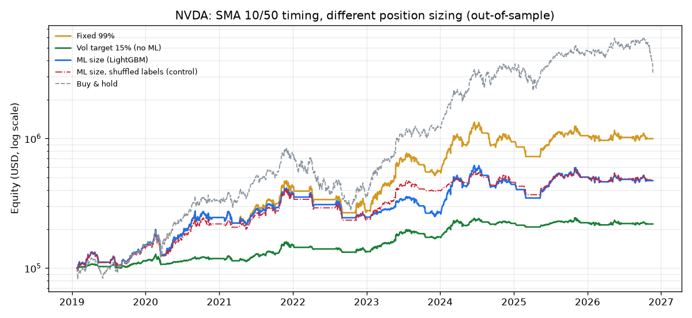
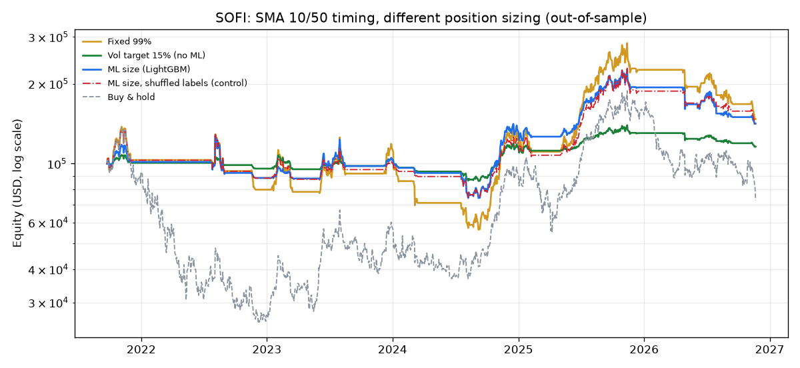

# Stage 2b: ML as a position-size filter for SMA 10/50

The model is trained only on days when SMA10 > SMA50, to predict whether the next 20 days are up (purged walk-forward, out-of-sample). Every scheme uses the same SMA entries and exits; only the size of each entry changes. Cost 0.03% per side.

Out-of-sample AUC on SMA-long days: LightGBM 0.471, logistic regression 0.437, shuffled-label control 0.474.

## Sharpe ratio by sizing scheme

| Scheme | SPY | QQQ | IWM | NVDA | SOFI | Average |
|---|---:|---:|---:|---:|---:|---:|
| Fixed 99% | 0.80 | 0.79 | 0.34 | 0.95 | 0.39 | 0.65 |
| Vol target 15% (no ML) | 0.63 | 0.66 | 0.12 | 0.77 | 0.30 | 0.50 |
| ML size (LightGBM) | 0.78 | 0.69 | 0.28 | 0.76 | 0.37 | 0.58 |
| ML gate (LightGBM) | 0.74 | 0.60 | 0.31 | 0.66 | 0.81 | 0.62 |
| ML size (logistic reg.) | 0.69 | 0.78 | 0.24 | 0.84 | 0.33 | 0.58 |
| ML size, shuffled labels (control) | 0.71 | 0.70 | 0.32 | 0.81 | 0.37 | 0.58 |
| Buy & hold | 0.82 | 0.85 | 0.47 | 1.13 | 0.23 | 0.70 |

## Return, drawdown and exposure

| Symbol | Scheme | Return | Max DD | Avg exposure | Trades |
|---|---:|---:|---:|---:|---:|
| SPY | Fixed 99% | +97.2% | -15.7% | 73% | 24 |
|  | Vol target 15% (no ML) | +49.7% | -13.1% | 56% | 24 |
|  | ML size (LightGBM) | +81.4% | -14.8% | 64% | 24 |
|  | ML gate (LightGBM) | +78.6% | -15.7% | 65% | 21 |
|  | ML size (logistic reg.) | +64.5% | -15.7% | 59% | 24 |
|  | ML size, shuffled labels (control) | +66.3% | -15.2% | 58% | 24 |
|  | Buy & hold | +193.4% | -33.8% | 100% | 1 |
| QQQ | Fixed 99% | +137.5% | -21.7% | 69% | 26 |
|  | Vol target 15% (no ML) | +60.3% | -12.8% | 44% | 26 |
|  | ML size (LightGBM) | +83.4% | -18.1% | 51% | 26 |
|  | ML gate (LightGBM) | +71.6% | -20.0% | 46% | 18 |
|  | ML size (logistic reg.) | +110.8% | -16.3% | 57% | 26 |
|  | ML size, shuffled labels (control) | +86.4% | -17.6% | 54% | 26 |
|  | Buy & hold | +295.0% | -35.0% | 100% | 1 |
| IWM | Fixed 99% | +39.3% | -35.1% | 62% | 26 |
|  | Vol target 15% (no ML) | +6.0% | -25.4% | 39% | 26 |
|  | ML size (LightGBM) | +25.1% | -30.7% | 49% | 26 |
|  | ML gate (LightGBM) | +32.3% | -34.8% | 52% | 23 |
|  | ML size (logistic reg.) | +18.6% | -29.6% | 47% | 26 |
|  | ML size, shuffled labels (control) | +28.4% | -27.9% | 48% | 26 |
|  | Buy & hold | +94.6% | -41.2% | 100% | 1 |
| NVDA | Fixed 99% | +896.5% | -46.1% | 69% | 29 |
|  | Vol target 15% (no ML) | +119.0% | -17.2% | 24% | 29 |
|  | ML size (LightGBM) | +373.1% | -44.4% | 59% | 29 |
|  | ML gate (LightGBM) | +269.2% | -59.4% | 59% | 27 |
|  | ML size (logistic reg.) | +440.4% | -40.4% | 55% | 29 |
|  | ML size, shuffled labels (control) | +379.9% | -42.7% | 54% | 29 |
|  | Buy & hold | +3067.2% | -66.3% | 100% | 1 |
| SOFI | Fixed 99% | +47.3% | -59.1% | 42% | 17 |
|  | Vol target 15% (no ML) | +15.8% | -20.3% | 12% | 17 |
|  | ML size (LightGBM) | +41.4% | -41.5% | 27% | 17 |
|  | ML gate (LightGBM) | +210.0% | -42.1% | 29% | 8 |
|  | ML size (logistic reg.) | +33.6% | -45.9% | 34% | 17 |
|  | ML size, shuffled labels (control) | +42.0% | -44.6% | 29% | 17 |
|  | Buy & hold | -27.2% | -81.5% | 100% | 1 |

## Did bigger bets go to better trades?

Spearman correlation between each scheme's bet size and the trade's return, across all 122 SMA entries (0 = no relationship):

| Scheme | Spearman ρ |
|---|---:|
| Vol target 15% (no ML) | +0.02 |
| ML size (LightGBM) | -0.13 |
| ML gate (LightGBM) | +0.04 |
| ML size (logistic reg.) | -0.11 |
| ML size, shuffled labels (control) | -0.06 |

## Charts

