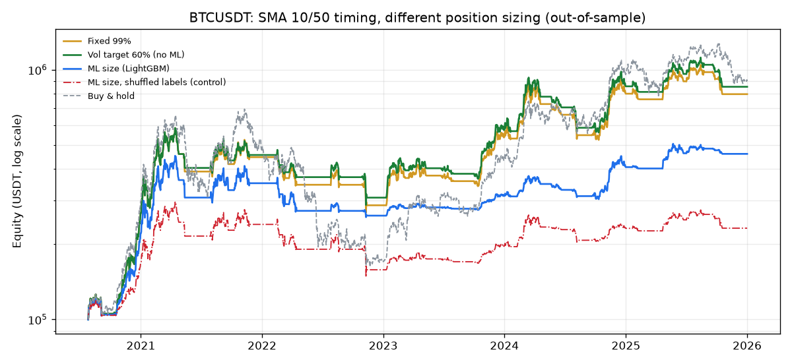
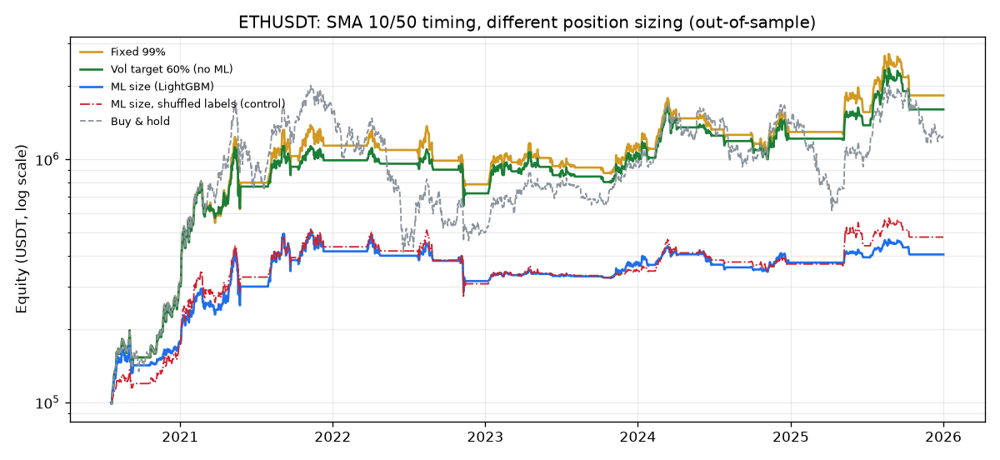
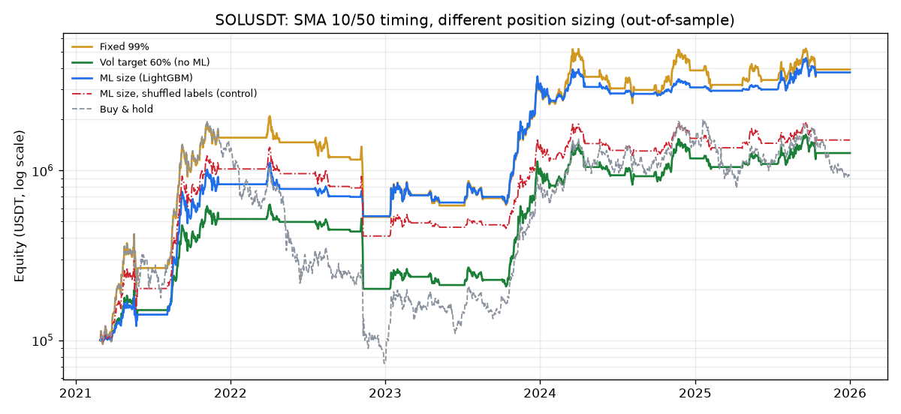

# Stage 2b: ML as a position-size filter for SMA 10/50

The model is trained only on days when SMA10 > SMA50, to predict whether the next 20 days are up (purged walk-forward, out-of-sample). Every scheme uses the same SMA entries and exits; only the size of each entry changes. Cost 0.15% per side.

Out-of-sample AUC on SMA-long days: LightGBM 0.515, logistic regression 0.492, shuffled-label control 0.483.

## Sharpe ratio by sizing scheme

| Scheme | BTCUSDT | ETHUSDT | SOLUSDT | Average |
|---|---:|---:|---:|---:|
| Fixed 99% | 1.11 | 1.19 | 1.34 | 1.21 |
| Vol target 60% (no ML) | 1.16 | 1.21 | 1.17 | 1.18 |
| ML size (LightGBM) | 1.04 | 0.86 | 1.52 | 1.14 |
| ML gate (LightGBM) | 1.06 | 0.47 | 1.43 | 0.99 |
| ML size (logistic reg.) | 0.82 | 0.88 | 1.15 | 0.95 |
| ML size, shuffled labels (control) | 0.68 | 0.91 | 1.20 | 0.93 |
| Buy & hold | 0.98 | 0.98 | 0.97 | 0.98 |

## Return, drawdown and exposure

| Symbol | Scheme | Return | Max DD | Avg exposure | Trades |
|---|---:|---:|---:|---:|---:|
| BTCUSDT | Fixed 99% | +697.8% | -54.2% | 53% | 23 |
|  | Vol target 60% (no ML) | +754.0% | -50.8% | 52% | 23 |
|  | ML size (LightGBM) | +360.1% | -43.2% | 33% | 23 |
|  | ML gate (LightGBM) | +442.2% | -48.6% | 30% | 12 |
|  | ML size (logistic reg.) | +239.9% | -51.7% | 35% | 23 |
|  | ML size, shuffled labels (control) | +131.9% | -49.9% | 31% | 23 |
|  | Buy & hold | +800.8% | -76.6% | 100% | 1 |
| ETHUSDT | Fixed 99% | +1727.1% | -49.6% | 52% | 25 |
|  | Vol target 60% (no ML) | +1500.9% | -44.0% | 47% | 25 |
|  | ML size (LightGBM) | +305.6% | -43.0% | 28% | 25 |
|  | ML gate (LightGBM) | +80.0% | -49.6% | 16% | 10 |
|  | ML size (logistic reg.) | +368.0% | -48.8% | 30% | 25 |
|  | ML size, shuffled labels (control) | +377.9% | -47.0% | 30% | 25 |
|  | Buy & hold | +1139.1% | -79.3% | 100% | 1 |
| SOLUSDT | Fixed 99% | +3830.5% | -74.7% | 50% | 18 |
|  | Vol target 60% (no ML) | +1166.3% | -68.2% | 38% | 18 |
|  | ML size (LightGBM) | +3681.3% | -51.8% | 35% | 18 |
|  | ML gate (LightGBM) | +2864.8% | -43.2% | 35% | 11 |
|  | ML size (logistic reg.) | +1067.7% | -73.5% | 32% | 18 |
|  | ML size, shuffled labels (control) | +1411.5% | -70.0% | 36% | 18 |
|  | Buy & hold | +842.1% | -96.3% | 100% | 1 |

## Did bigger bets go to better trades?

Spearman correlation between each scheme's bet size and the trade's return, across all 66 SMA entries (0 = no relationship):

| Scheme | Spearman ρ |
|---|---:|
| Vol target 60% (no ML) | -0.02 |
| ML size (LightGBM) | +0.02 |
| ML gate (LightGBM) | +0.01 |
| ML size (logistic reg.) | -0.21 |
| ML size, shuffled labels (control) | -0.35 |

## Charts

