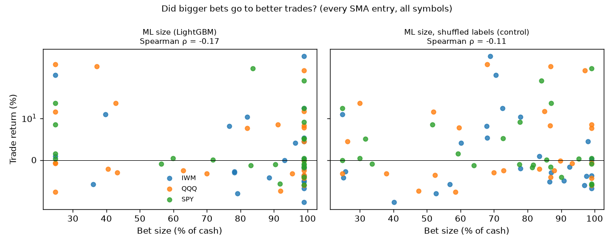
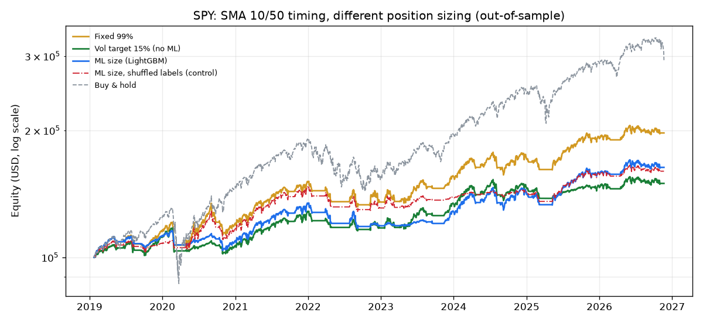
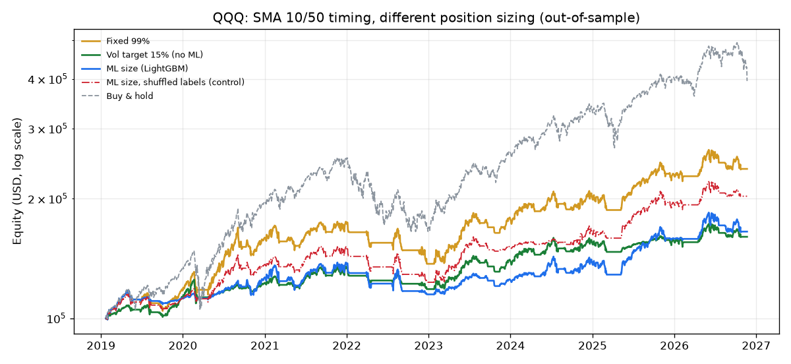
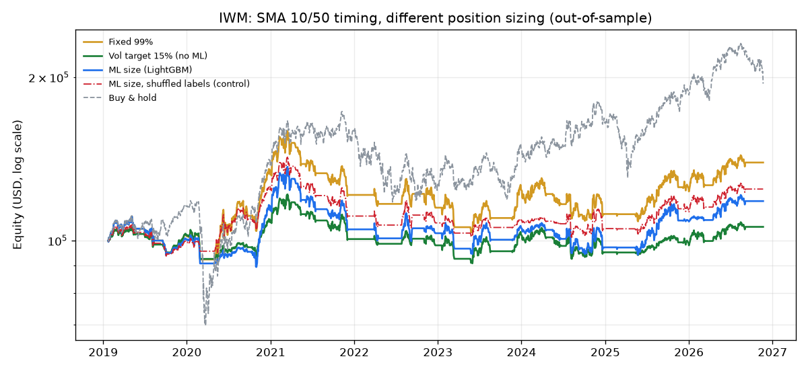

# Stage 2b: ML as a position-size filter for SMA 10/50

The model is trained only on days when SMA10 > SMA50, to predict whether the next 20 days are up (purged walk-forward, out-of-sample). Every scheme uses the same SMA entries and exits; only the size of each entry changes. Cost 0.03% per side.

Out-of-sample AUC on SMA-long days: LightGBM 0.490, logistic regression 0.506, shuffled-label control 0.468.

## Sharpe ratio by sizing scheme

| Scheme | SPY | QQQ | IWM | Average |
|---|---:|---:|---:|---:|
| Fixed 99% | 0.80 | 0.79 | 0.34 | 0.64 |
| Vol target 15% (no ML) | 0.63 | 0.66 | 0.12 | 0.47 |
| ML size (LightGBM) | 0.72 | 0.60 | 0.23 | 0.52 |
| ML gate (LightGBM) | 0.64 | 0.38 | 0.16 | 0.39 |
| ML size (logistic reg.) | 0.79 | 0.75 | 0.26 | 0.60 |
| ML size, shuffled labels (control) | 0.70 | 0.79 | 0.29 | 0.59 |
| Buy & hold | 0.82 | 0.85 | 0.47 | 0.71 |

## Return, drawdown and exposure

| Symbol | Scheme | Return | Max DD | Avg exposure | Trades |
|---|---:|---:|---:|---:|---:|
| SPY | Fixed 99% | +97.2% | -15.7% | 73% | 24 |
|  | Vol target 15% (no ML) | +49.7% | -13.1% | 56% | 24 |
|  | ML size (LightGBM) | +63.4% | -13.0% | 59% | 24 |
|  | ML gate (LightGBM) | +57.5% | -17.5% | 60% | 20 |
|  | ML size (logistic reg.) | +84.6% | -15.4% | 66% | 24 |
|  | ML size, shuffled labels (control) | +60.0% | -14.8% | 52% | 24 |
|  | Buy & hold | +193.4% | -33.8% | 100% | 1 |
| QQQ | Fixed 99% | +137.5% | -21.7% | 69% | 26 |
|  | Vol target 15% (no ML) | +60.3% | -12.8% | 44% | 26 |
|  | ML size (LightGBM) | +65.2% | -16.9% | 50% | 26 |
|  | ML gate (LightGBM) | +33.7% | -20.0% | 41% | 17 |
|  | ML size (logistic reg.) | +103.8% | -15.9% | 58% | 26 |
|  | ML size, shuffled labels (control) | +102.7% | -18.7% | 53% | 26 |
|  | Buy & hold | +295.0% | -35.0% | 100% | 1 |
| IWM | Fixed 99% | +39.3% | -35.1% | 62% | 26 |
|  | Vol target 15% (no ML) | +6.0% | -25.4% | 39% | 26 |
|  | ML size (LightGBM) | +18.2% | -31.2% | 49% | 26 |
|  | ML gate (LightGBM) | +9.9% | -34.8% | 47% | 22 |
|  | ML size (logistic reg.) | +22.1% | -29.3% | 46% | 26 |
|  | ML size, shuffled labels (control) | +24.4% | -28.8% | 45% | 26 |
|  | Buy & hold | +94.6% | -41.2% | 100% | 1 |

## Did bigger bets go to better trades?

Spearman correlation between each scheme's bet size and the trade's return, across all 76 SMA entries (0 = no relationship):

| Scheme | Spearman ρ |
|---|---:|
| Vol target 15% (no ML) | -0.11 |
| ML size (LightGBM) | -0.17 |
| ML gate (LightGBM) | -0.24 |
| ML size (logistic reg.) | -0.08 |
| ML size, shuffled labels (control) | -0.11 |

## Charts

