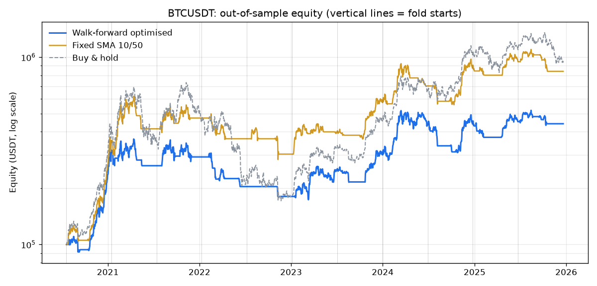
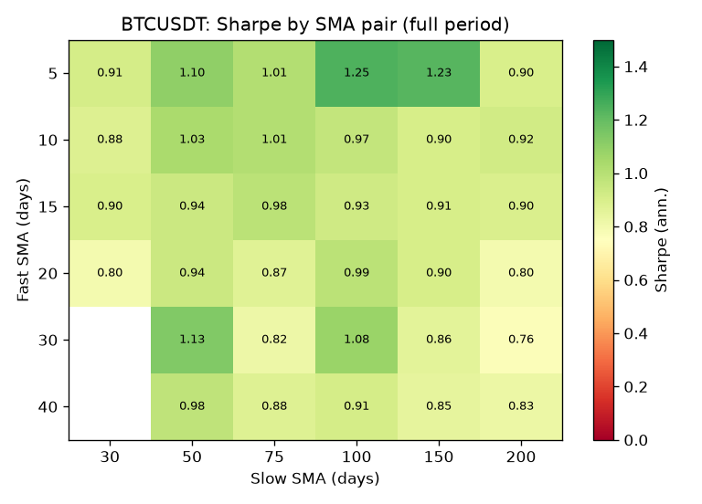
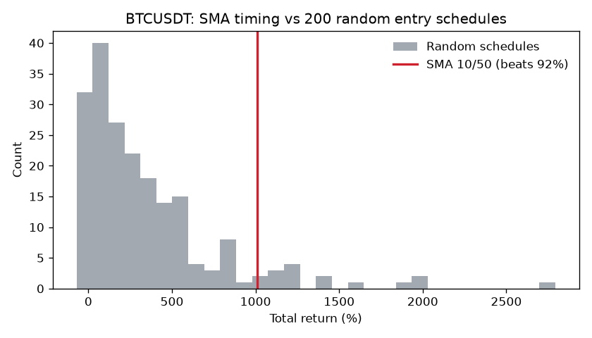
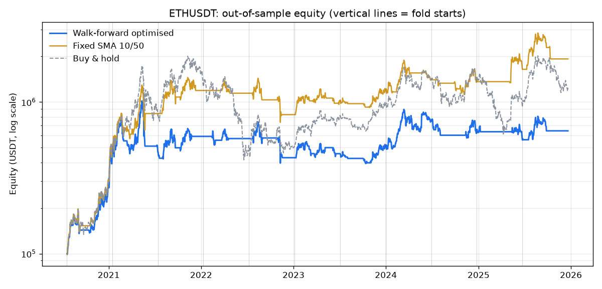
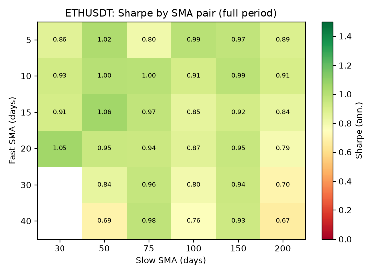
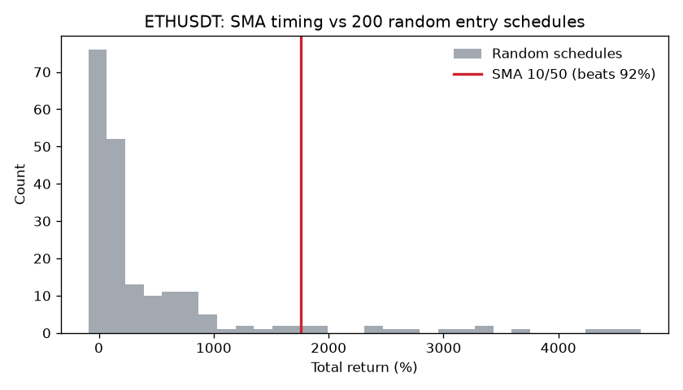
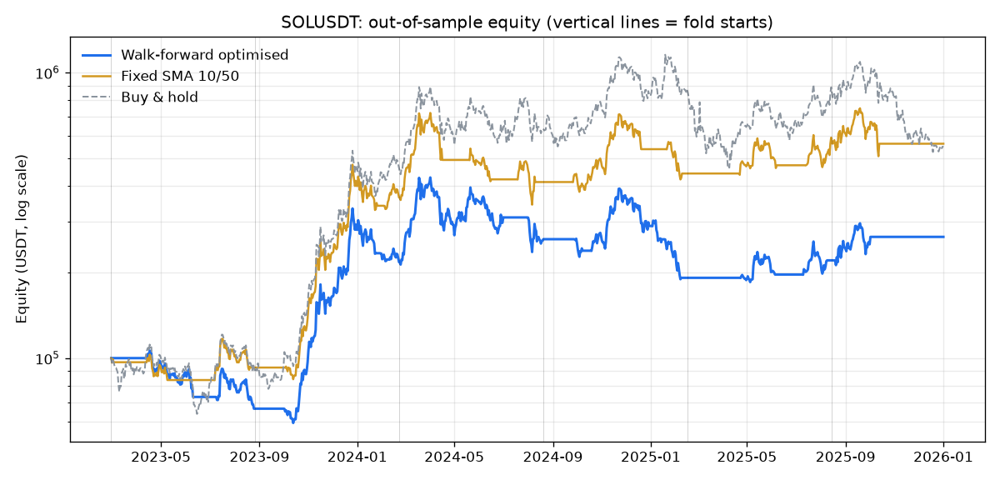
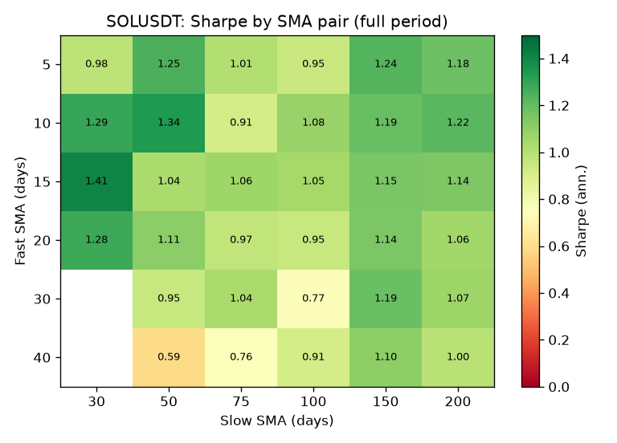
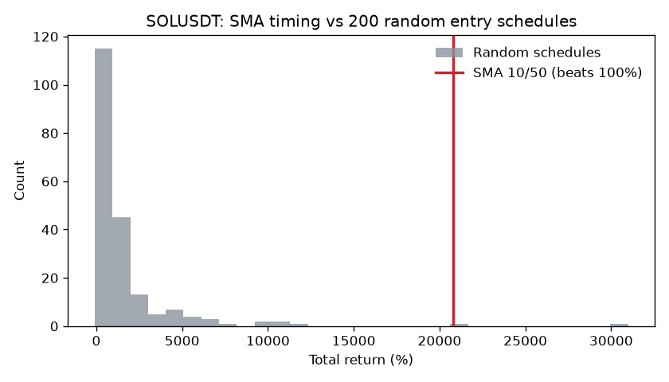

# Stage 1 research summary

Execution assumptions: 99% of free cash per entry, 0.15% cost per side (0.10% fee + 0.05% slippage), market orders filled at the signal bar's close, long only.

## Walk-forward (out-of-sample only)

Train 730 days, choose the best of 34 SMA pairs by Sharpe, trade it for the next 180 days, roll forward.

| Symbol | Approach | OOS period | Return | Max DD | Sharpe |
|---|---|---|---:|---:|---:|
| BTCUSDT | Walk-forward | 2020-07-19 to 2025-12-19 | +341.2% | -52.6% | 0.87 |
|  | Fixed 10/50 |  | +739.9% | -54.1% | 1.14 |
|  | Buy & hold |  | +854.2% | -76.6% | 1.00 |
| ETHUSDT | Walk-forward | 2020-07-19 to 2025-12-19 | +545.8% | -61.3% | 0.88 |
|  | Fixed 10/50 |  | +1825.2% | -49.6% | 1.21 |
|  | Buy & hold |  | +1142.3% | -79.3% | 0.98 |
| SOLUSDT | Walk-forward | 2023-02-27 to 2025-12-31 | +165.7% | -57.0% | 0.85 |
|  | Fixed 10/50 |  | +463.0% | -52.3% | 1.26 |
|  | Buy & hold |  | +448.0% | -59.8% | 1.12 |

## Parameter sensitivity (full period)

| Symbol | Pairs | Sharpe min | median | max | Best pair | 10/50 | Pairs profitable |
|---|---:|---:|---:|---:|---:|---:|---:|
| BTCUSDT | 34 | 0.76 | 0.91 | 1.25 | 5/100 | 1.03 | 100% |
| ETHUSDT | 34 | 0.67 | 0.92 | 1.06 | 15/50 | 1.00 | 100% |
| SOLUSDT | 34 | 0.59 | 1.07 | 1.41 | 15/30 | 1.34 | 100% |

## Random-entry baseline (SMA 10/50, full period)

| Symbol | Strategy return | Random median | Beats (return) | Beats (Sharpe) |
|---|---:|---:|---:|---:|
| BTCUSDT | +1010.6% | +216.1% | 92% | 92% |
| ETHUSDT | +1761.1% | +121.0% | 92% | 92% |
| SOLUSDT | +20778.6% | +656.1% | 100% | 99% |

Random schedules have the same number of trades and holding lengths as the strategy (200 samples each).

## Cost and delay robustness (SMA 10/50, full period, Sharpe)

**BTCUSDT**

| Cost / side | delay 0 | delay 1 | delay 2 |
|---|---:|---:|---:|
| 0.10% | 0.92 | 0.81 | 0.73 |
| 0.15% | 0.91 | 0.80 | 0.72 |
| 0.20% | 0.90 | 0.79 | 0.71 |
| 0.30% | 0.88 | 0.77 | 0.69 |

**ETHUSDT**

| Cost / side | delay 0 | delay 1 | delay 2 |
|---|---:|---:|---:|
| 0.10% | 0.92 | 0.86 | 0.93 |
| 0.15% | 0.92 | 0.86 | 0.92 |
| 0.20% | 0.91 | 0.85 | 0.92 |
| 0.30% | 0.89 | 0.84 | 0.90 |

**SOLUSDT**

| Cost / side | delay 0 | delay 1 | delay 2 |
|---|---:|---:|---:|
| 0.10% | 1.58 | 1.47 | 1.23 |
| 0.15% | 1.57 | 1.46 | 1.22 |
| 0.20% | 1.57 | 1.46 | 1.22 |
| 0.30% | 1.56 | 1.45 | 1.21 |

## Charts

### BTCUSDT

 

### ETHUSDT

 

### SOLUSDT

 
