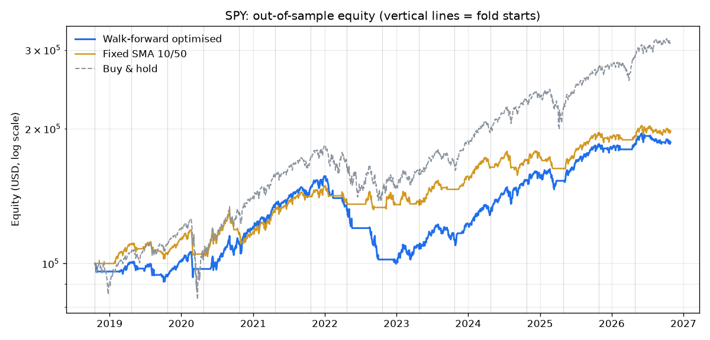
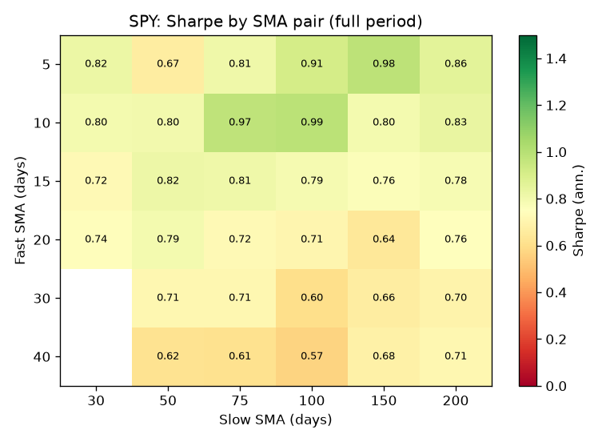
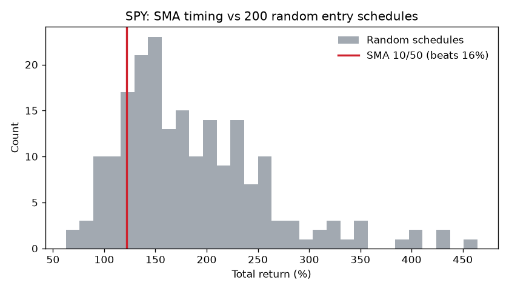
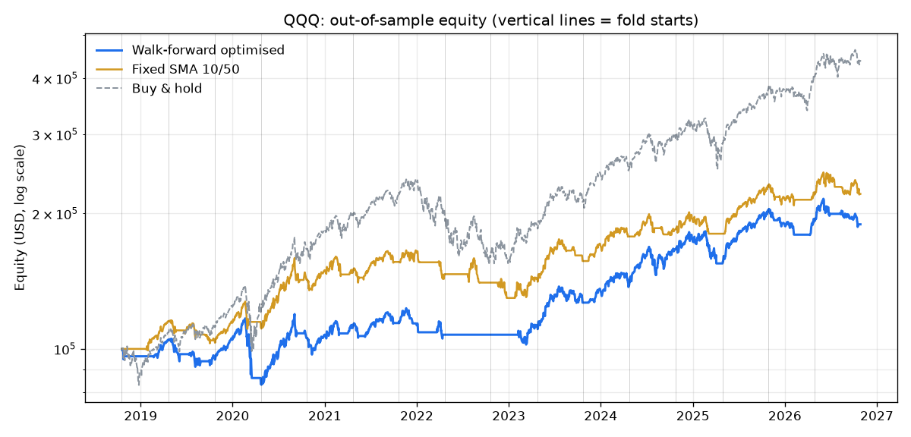
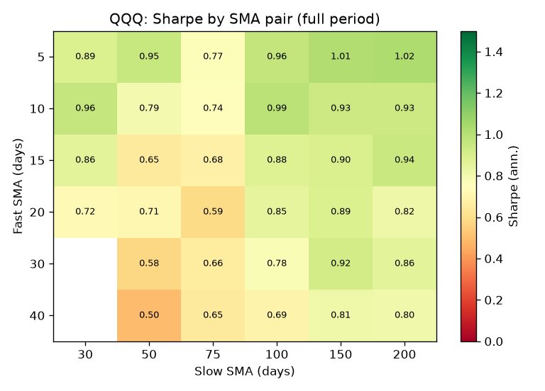
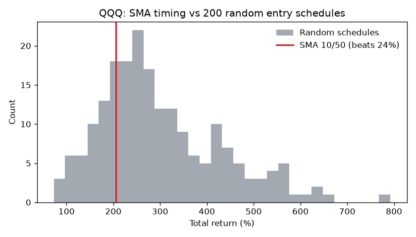
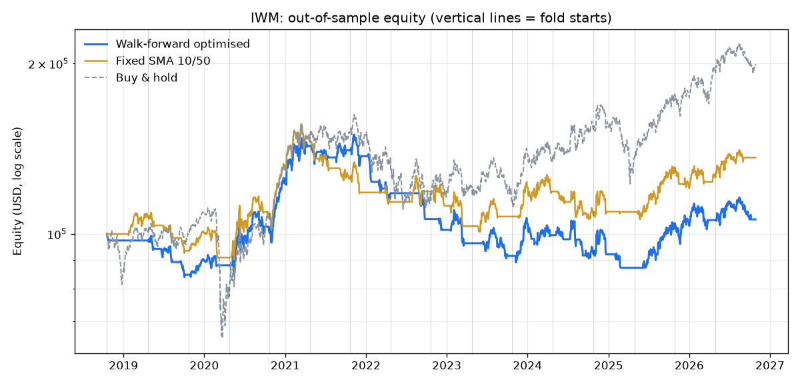
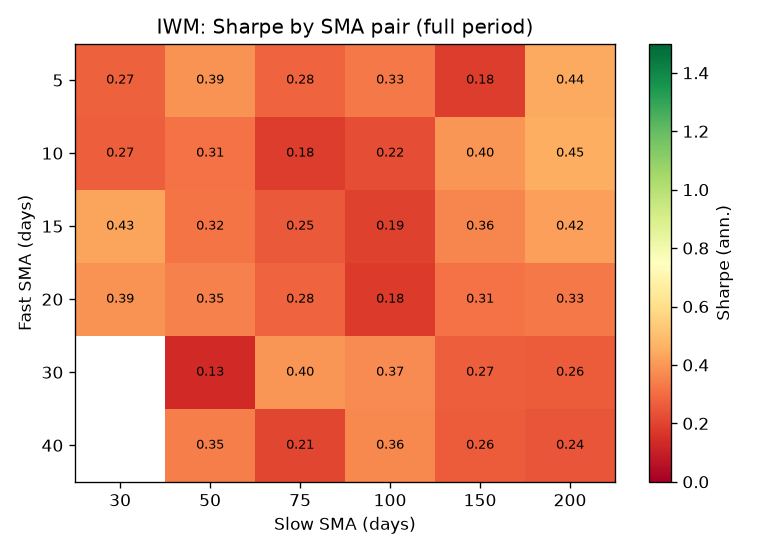
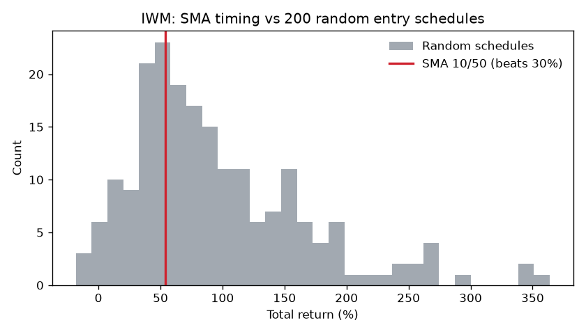

# Stage 1 research summary

Execution assumptions: 99% of free cash per entry, 0.03% cost per side, decided at the close and filled at the next open (1 bp half-spread), long only.

## Walk-forward (out-of-sample only)

Train 504 sessions, choose the best of 34 SMA pairs by Sharpe, trade it for the next 126 sessions, roll forward.

| Symbol | Approach | OOS period | Return | Max DD | Sharpe |
|---|---|---|---:|---:|---:|
| SPY | Walk-forward | 2018-10-18 to 2026-10-27 | +86.5% | -36.3% | 0.68 |
|  | Fixed 10/50 |  | +97.8% | -16.0% | 0.80 |
|  | Buy & hold |  | +213.7% | -33.8% | 0.85 |
| QQQ | Walk-forward | 2018-10-18 to 2026-10-27 | +89.3% | -28.8% | 0.57 |
|  | Fixed 10/50 |  | +121.2% | -21.7% | 0.72 |
|  | Buy & hold |  | +339.1% | -35.0% | 0.89 |
| IWM | Walk-forward | 2018-10-18 to 2026-10-27 | +6.1% | -41.9% | 0.13 |
|  | Fixed 10/50 |  | +36.4% | -35.5% | 0.32 |
|  | Buy & hold |  | +99.5% | -41.2% | 0.47 |

## Parameter sensitivity (full period)

| Symbol | Pairs | Sharpe min | median | max | Best pair | 10/50 | Pairs profitable |
|---|---:|---:|---:|---:|---:|---:|---:|
| SPY | 34 | 0.57 | 0.76 | 0.99 | 10/100 | 0.80 | 100% |
| QQQ | 34 | 0.50 | 0.83 | 1.02 | 5/200 | 0.79 | 100% |
| IWM | 34 | 0.13 | 0.31 | 0.45 | 10/200 | 0.31 | 100% |

## Random-entry baseline (SMA 10/50, full period)

| Symbol | Strategy return | Random median | Beats (return) | Beats (Sharpe) |
|---|---:|---:|---:|---:|
| SPY | +121.7% | +169.9% | 16% | 57% |
| QQQ | +205.8% | +272.0% | 24% | 56% |
| IWM | +54.0% | +77.7% | 30% | 38% |

Random schedules have the same number of trades and holding lengths as the strategy (200 samples each).

## Cost and delay robustness (SMA 10/50, full period, Sharpe)

**SPY**

| Cost / side | delay 0 | delay 1 | delay 2 |
|---|---:|---:|---:|
| 0.01% | 0.75 | 0.71 | 0.78 |
| 0.03% | 0.74 | 0.70 | 0.77 |
| 0.05% | 0.72 | 0.69 | 0.76 |
| 0.10% | 0.70 | 0.67 | 0.74 |

**QQQ**

| Cost / side | delay 0 | delay 1 | delay 2 |
|---|---:|---:|---:|
| 0.01% | 0.79 | 0.82 | 0.70 |
| 0.03% | 0.78 | 0.81 | 0.69 |
| 0.05% | 0.78 | 0.80 | 0.68 |
| 0.10% | 0.76 | 0.78 | 0.66 |

**IWM**

| Cost / side | delay 0 | delay 1 | delay 2 |
|---|---:|---:|---:|
| 0.01% | 0.35 | 0.38 | 0.34 |
| 0.03% | 0.34 | 0.37 | 0.33 |
| 0.05% | 0.33 | 0.36 | 0.32 |
| 0.10% | 0.31 | 0.34 | 0.30 |

## Charts

### SPY

 

### QQQ

 

### IWM

 
