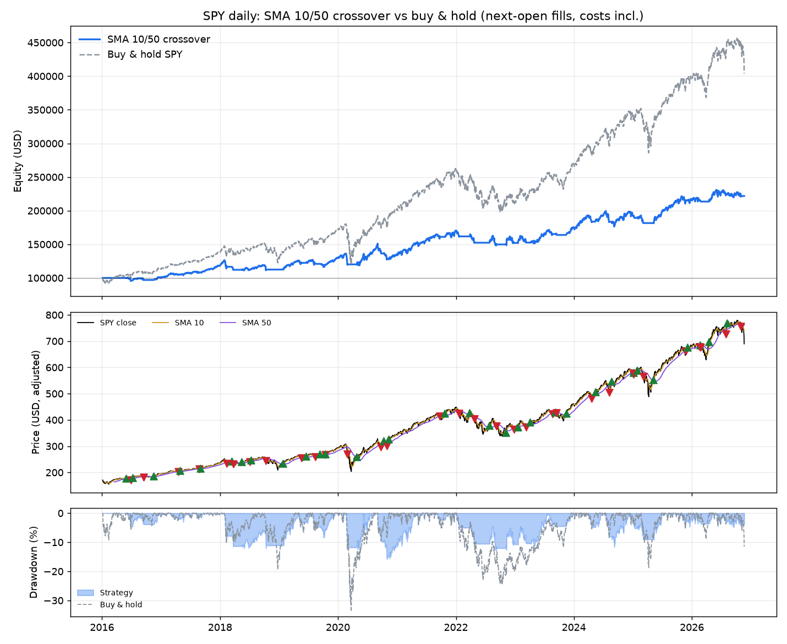
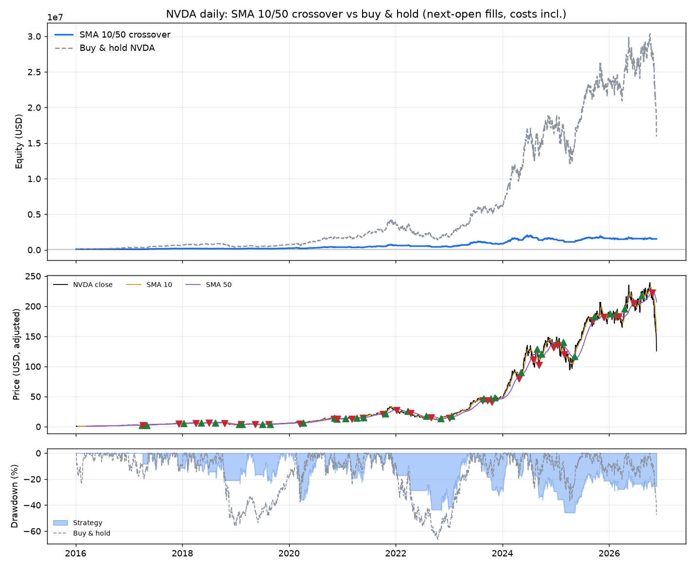
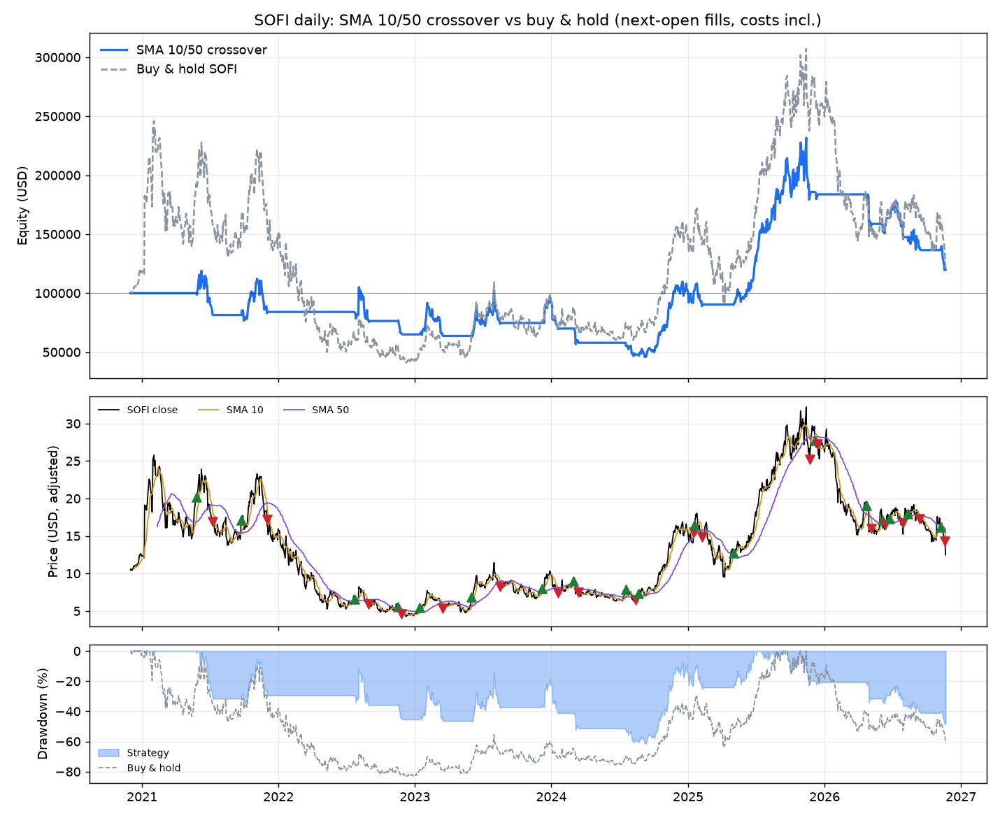

# SMA 10/50 on ETFs

| Symbol | Period | Strategy return | B&H return | Strategy max DD | B&H max DD | Strategy Sharpe | B&H Sharpe | Trades |
|---|---|---:|---:|---:|---:|---:|---:|---:|
| SPY | 2016-01-04 to 2026-11-20 | +121.75% | +303.91% | -15.70% | -33.79% | 0.74 | 0.82 | 32 |
| QQQ | 2016-01-04 to 2026-11-20 | +205.95% | +501.05% | -21.69% | -35.00% | 0.78 | 0.85 | 32 |
| IWM | 2016-01-04 to 2026-11-20 | +53.94% | +167.17% | -35.11% | -41.27% | 0.34 | 0.51 | 35 |
| NVDA | 2016-01-04 to 2026-11-20 | +1437.53% | +15826.71% | -46.09% | -66.33% | 0.88 | 1.19 | 34 |
| SOFI | 2020-11-30 to 2026-11-20 | +19.98% | +19.01% | -61.44% | -83.32% | 0.28 | 0.38 | 18 |

